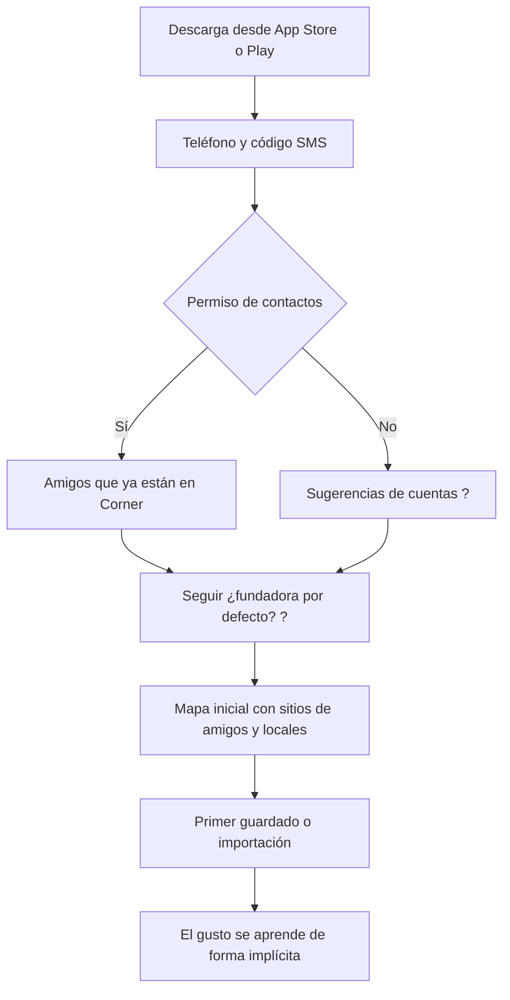
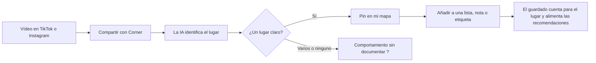
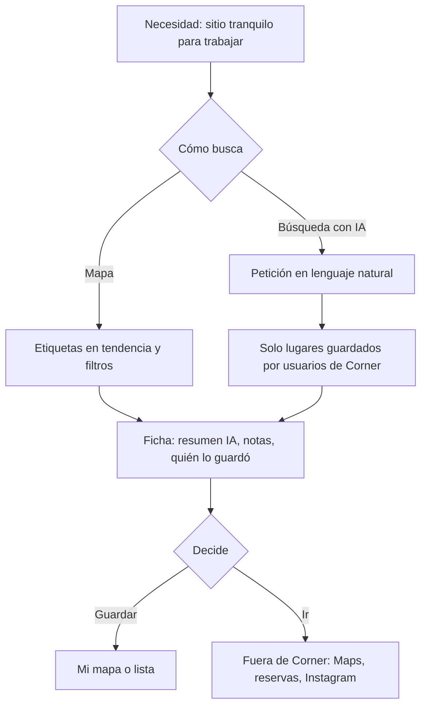
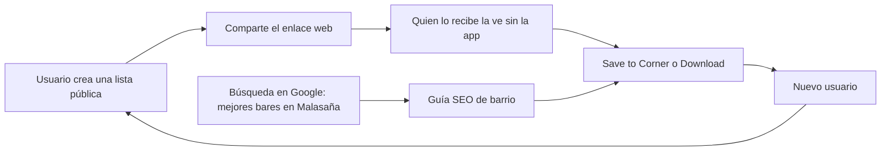

# Corner: ingeniería inversa funcional v2

> **Etiquetas de este documento:** `CONFIRMADO` (fuente primaria de Corner, editorial de Apple o prensa fiable; entre corchetes, la fuerza: [primaria], [editorial] o [secundaria] si es una reimpresión o un agregador), `INFERIDO` (hipótesis razonable a partir de lo observado) y `PROPUESTO` (sugerencia para GoLiveIt). Equivalencias con [[Evidencias]]: CONFIRMADO[primaria] = VERIFICADO, CONFIRMADO[secundaria] = SECUNDARIA, INFERIDO = HIPÓTESIS.
> No se nombra a usuarios particulares de Corner. Solo aparecen los cofundadores, que son la cara pública de la marca.

## 0. Resumen ejecutivo

1. La v1 era sólida en lo legal y en el inventario general, pero **daba por buenas tres cosas que no lo son del todo**: que el mapa es un «mundo cerrado» también en datos, que existe una ficha pública `/place/{id}` y que solo hay app para iOS.
2. **El «mundo cerrado» es una capa de visibilidad, no de datos.** Las URL públicas de lugar usan identificadores con el formato de Google Place ID (`ChIJ…`), y una oferta de empleo habla de ETL con *web scraping* hacia un «índice de lugares» (`INFERIDO` + `CONFIRMADO[secundaria]`).
3. **El stack ya tiene respaldo público**: iOS nativo (Swift, UIKit + SwiftUI, RxSwift) con **Mapbox**, según su propia oferta en Notion `[primaria]`. En la web también se ve Mapbox. La búsqueda con IA usa **Claude de Anthropic** «y otras tecnologías» (Business Insider, sept. 2025, `[secundaria]`), y el *backend* usa *embeddings* de texto e imagen (oferta de empleo, `[secundaria]`).
4. **No hay estrellas ni ranking.** La señal de gusto son los guardados, las notas libres, las etiquetas y los contadores públicos (guardados y vistas). Es justo lo contrario de Beli.
5. **No se ha encontrado ninguna función de rutas o itinerarios.** «Hacer planes con amigos» aparece como lema en la tienda y en un titular, pero sin una función descrita.
6. **Las guías son SEO programático**: ciudad → barrio → artículo con plantilla de título fija. En Madrid, la mayoría tratan de discotecas, bares y coctelerías, contenido **inadecuado para 16-17 años**.
7. Monetización: **ningún ingreso declarado** (sept. 2025). Hay planes de *premium* y de acuerdos con pequeños negocios, y una tienda de *merch* en la web.
8. Retención observada: «hot lists this week», etiquetas en tendencia, un teletipo de actividad y notificaciones. **No hay pruebas de rachas.**
9. No hay ningún buscador accesible sin sesión, así que **no se hizo ninguna consulta** y no se simula ningún resultado. La sección 6 deja un protocolo para que lo pruebe un miembro del equipo mayor de edad con su propia cuenta.
10. Lo que nos llevamos: separar el **catálogo** de lo **visible y verificado**, dar a cada dato una **autoría** (fuente oficial, IA o persona), usar una **señal de feedback binaria y útil** en lugar de estrellas, y crecer con **páginas web compartibles** sin pedir la app.

## 1. Auditoría de la v1

### 1.1 Posibles errores de interpretación

| # | Afirmación en la v1 | Qué se ve ahora | Corrección propuesta | Etiqueta |
|---|---|---|---|---|
| AU-1 | «Un lugar entra en el mapa de Corner solo cuando un usuario lo guarda» se interpreta como una base de lugares propia y cerrada | Los enlaces de lugar en una lista pública apuntan a `/place/ChIJ…`, el formato de identificador de Google Places. La web de un local enlaza con `utm_source=GoogleMyBusiness`. La oferta *AI Backend Engineer* habla de ETL «desde lo que aportan los usuarios y web scraping» hacia un «place index» | El catálogo de lugares se nutre de fuentes externas. Lo que es cerrado es **qué se muestra**: solo lo que algún usuario ha guardado | INFERIDO (ID) + CONFIRMADO[secundaria] (oferta) |
| AU-2 | W05 `/place/{id}`: «Ficha pública de lugar» | El 08/11/2026, el enlace de lugar de una lista pública lleva a una página de error («are you lost?») ([[#4. Capturas\|captura 05]]) | La ficha web pública **no está disponible**, o no lo está para ese tipo de ID. El valor de la ficha está dentro de la app | CONFIRMADO[primaria] (observado) |
| AU-3 | Inventario «App (iOS)» | Google Play tiene una ficha titulada «corner: curate & share places». TechCrunch (06/06/2026) decía «iOS only». La portada solo enlaza a la App Store | Existe versión Android, probablemente posterior a junio de 2026; no se sabe si tiene las mismas funciones que la de iOS | CONFIRMADO[primaria] (título) + INFERIDO (fecha) |
| AU-4 | «Recomendaciones según tus reseñas» | Corner **no usa estrellas** (Business Insider): las «reseñas» son notas libres | Llamarlas «notas» o «reseñas sin puntuación». No hay ninguna señal numérica explícita | CONFIRMADO[secundaria] |
| AU-5 | Cifras: 250.000 usuarios (prensa) y 350.000 (portada) | La portada dice «350k tastemakers», la página de guías dice «80,000 gen z tastemakers», TechCrunch (jun. 2026) dice «125,000+» y BI (sept. 2025) decía 55.000 | Todas las cifras son **declaradas por la empresa** y no coinciden entre sí. No usarlas como métrica | CONFIRMADO (las cifras) / INFERIDO (texto desactualizado) |
| AU-6 | «Guías por ciudad», con el contador como si fuera el número de guías | El contador («Lisbon 482 guides») cuenta **artículos**. La estructura es `/guides/{ciudad}/{barrio}/{artículo}` y los títulos siguen una plantilla («Hidden Gems: Best … in …») que se repite en cada barrio | Son páginas SEO generadas a escala a partir de reseñas, que según la propia web se actualizan a diario | CONFIRMADO (estructura) + INFERIDO (generación asistida) |
| AU-7 | «Ritmo de actualizaciones de 1-3 semanas» como señal | 10 versiones entre el 4 de septiembre y principios de noviembre de 2026, pero **todas las notas de versión son genéricas** («fixes and refinements») | El ritmo es real, pero las notas de versión **no sirven** para saber qué funciones salen | CONFIRMADO[primaria] |

### 1.2 Hipótesis tecnológicas de la v1 y su respaldo actual

| Hipótesis v1 | Respaldo nuevo | Estado |
|---|---|---|
| A-1 Filtrado colaborativo + peso de la red | Solo el lema de una oferta: «where people like you are going» (a dónde va gente como tú). No dice el método | Sigue siendo INFERIDO. **No hay pruebas del método** |
| A-2 Búsqueda semántica con vectores + LLM | BI: búsqueda con IA «built using Anthropic's Claude» y otras tecnologías. Oferta: «text and image embeddings» para mejorar la búsqueda | Parcialmente respaldada: hay *embeddings* y LLM. Se desconocen la arquitectura y el proveedor de vectores |
| A-3 Arranque en frío con contactos e importación | La CEO tiene 321.000 seguidores frente a unos 350.000 usuarios declarados | INFERIDO: es probable que **se siga automáticamente a la fundadora al registrarse**, o que se sugiera con mucha fuerza. Hay que verificarlo (E1) |
| A-4 Extracción con LLM o visión | El fundador: la IA extrae «key details and the emotional connections». Hay *embeddings* de imagen | INFERIDO: no hay pruebas de un modelo de visión concreto |

### 1.3 Funcionalidades poco investigadas o pasadas por alto en la v1

- **Onboarding y gustos:** la v1 no dice si existe un cuestionario de gustos. **No hay ninguna fuente pública que lo describa** (laguna, E1).
- **Contadores públicos** (guardados por lugar, vistas y guardados por lista, lugares, seguidos y seguidores por perfil) como prueba social y como señal.
- **Perfil público** con mapa de calor mundial, botones por ciudad con contador («new york 1045») y «curations» (así llaman a las listas en la web).
- **Ficha en tres capas** dentro de la lista: emoji con microcategoría, titular y párrafo de tono uniforme (probable texto de IA), y la nota del usuario en minúsculas con la fecha relativa.
- **Filtros por categoría dentro de una lista** («eat», «cafes»).
- **Monetización:** tienda de *merch*, planes de *premium* y acuerdos con negocios, revista digital y eventos.
- **Idiomas:** la app ya está en español, francés, alemán e italiano (App Store EE. UU.). Es compatible con visionOS.
- **Moderación y edad del contenido:** listas con lenguaje sexual o de fiesta y guías centradas en alcohol, coherente con la clasificación 16+/17+.

### 1.4 Funciones que merecen un experimento

Onboarding (E1), personalización entre perfiles (E2), efecto de los guardados (E3), cambio de gustos (E4), precisión semántica (E5), ubicación y hora (E6), estabilidad del orden (E7), importación desde TikTok e Instagram (E8) e influencia social (E9). Detalle en la sección 6.

## 2. Fichas de funcionalidades

### 2.1 Tabla resumen

| ID | Funcionalidad | Qué hace | Datos que usa | Cómo interactúa el usuario | Qué devuelve | Valor | Etiqueta |
|---|---|---|---|---|---|---|---|
| FN-01 | Registro y onboarding | Alta con teléfono y SMS y búsqueda de amigos por contactos | Teléfono, contactos, nombre | Formulario y permisos | Cuenta y red inicial | Grafo social desde el día 1 | CONFIRMADO (teléfono y contactos) / INFERIDO (pasos y seguimiento automático) |
| FN-02 | Gustos | «Aprende tu gusto» a partir del uso | Guardados, notas, ubicación, movimientos | Implícito: guardar y escribir notas | Recomendaciones | Sin cuestionario largo | CONFIRMADO (implícito) / laguna (explícito) |
| FN-03 | Mapa | Mapa personal y de descubrimiento, «Locate me» y etiquetas en tendencia | Guardados propios, de amigos y de locales | Desplazar el mapa, filtrar, tocar un pin | Pines y ficha | Descubrir alrededor | CONFIRMADO |
| FN-04 | Ficha de lugar | Resumen de ambiente con IA, fotos, enlaces y quién lo guardó | Notas de usuarios, metadatos, fotos | Tocar un pin o un elemento de lista | Resumen, notas, enlaces, botón de guardar | Decidir rápido | CONFIRMADO (app) / ficha web no disponible (AU-2) |
| FN-05 | Captura desde enlaces | Compartir un TikTok, Instagram, Maps o web → pin | URL y contenido de la publicación | Menú «Compartir» del sistema | Lugar identificado y guardado | Captura sin fricción | CONFIRMADO (anunciado) / fiabilidad sin verificar |
| FN-06 | Búsqueda con IA | Consultas en lenguaje natural | Reseñas y contenido de Corner, metadatos | Escribir una petición | Lugares guardados por usuarios | Entiende «el ambiente» | CONFIRMADO[secundaria] |
| FN-07 | Recomendaciones | Sugerencias según gusto, red y ubicación | Preferencias, ubicación, red | Pasivo (mapa e inicio) | Lugares | Personalización | CONFIRMADO (declarado) / método INFERIDO |
| FN-08 | Social | Seguir, perfiles públicos, actividad | Grafo de seguimiento | Seguir, ver perfiles | Sitios de otros, teletipo | Confianza en personas | CONFIRMADO |
| FN-09 | Notas y comentarios | Nota del autor por lugar, comentarios y publicaciones | Texto y fotos | Escribir | Texto visible con fecha | Contexto humano | CONFIRMADO |
| FN-10 | Listas («curations») | Temáticas, públicas o privadas, con filtros | Lugares guardados | Crear, ordenar, compartir por enlace | Lista web visible sin app | Identidad y crecimiento | CONFIRMADO |
| FN-11 | Feedback sin estrellas | Guardados, notas, etiquetas y contadores | Acciones del usuario | Guardar, anotar, etiquetar | Contadores públicos | Señal positiva, no punitiva | CONFIRMADO |
| FN-12 | Planes y rutas | «Make plans with friends» como lema | — | — | — | — | **No confirmado** |
| FN-13 | Retención | Tendencias, «hot lists this week», actividad, notificaciones | Actividad agregada | Pasivo | Novedad semanal | Volver a la app | CONFIRMADO (piezas) / rachas sin pruebas |
| FN-14 | Guías SEO | Artículos por ciudad, barrio y categoría | Reseñas agregadas | Lectura en la web | Listas de lugares | Captación orgánica | CONFIRMADO / generación INFERIDA |
| FN-15 | Monetización | Ninguna de momento; *merch*; planes | — | Comprar *merch* | — | — | CONFIRMADO |

### 2.2 Detalle

**FN-01 Registro y onboarding.** Corner pide el teléfono y el código SMS (reseñas españolas, E-25) y usa los contactos para ver quién está ya en la app (privacidad, E-22). La CEO tiene 321.000 seguidores y la portada declara unos 350.000 usuarios. Lo más probable es que **el onboarding siga o sugiera seguir a la fundadora** (`INFERIDO`). No hay ninguna fuente pública con los pasos de la pantalla de bienvenida. Valor: el grafo social y el arranque en frío. Evidencia: perfil público `https://www.corner.inc/eliza` (REA `ev_8667b3e5…`, 08/11/2026).

**FN-02 Configuración de gustos.** La tienda dice que las recomendaciones se ajustan «a tus reseñas y guardados». La oferta de backend presenta Corner como el mapa «que aprende tu gusto». No se ha encontrado prensa ni editorial que describa un **selector explícito de gustos** (categorías o *vibes*) en el alta: es una laguna. Valor: menos fricción en el alta, a cambio de un arranque frío más lento. `CONFIRMADO` (implícito) / `INFERIDO` (que no hay cuestionario, sin verificar).

**FN-03 Mapa.** Muestra los sitios propios, los de amigos y los de «locals» (Apple, *Meet the Developer*), con etiquetas en tendencia en el mapa («para descubrir sitios antes de que se llenen», Jake Xia). En la web, el perfil enseña un mapa mundial con zonas de calor y botones por ciudad con contador. La lista pública tiene «Locate me». El mapa web lleva la atribución de **Mapbox** (captura 04). `CONFIRMADO`.

**FN-04 Ficha de lugar.** En la app: resumen de ambiente con IA («¿mejor para una segunda cita que para la primera?»), según Apple. En la lista web, cada lugar tiene tres capas: (a) **emoji + microcategoría** («🥯 sourdough bagels»), (b) **titular y párrafo** con un tono uniforme y consejos prácticos («the … is the move», tiempo de espera, límite de mesa), y (c) **la nota del usuario** en minúsculas con la fecha relativa («1y ago»). Además: dirección y barrio, contador de guardados, enlaces a Instagram y a la web, y a veces a reservas (Resy). Que la capa (b) es texto generado lo deducimos del tono y de que la privacidad declara «descripciones generadas» (`INFERIDO`). La ficha web `/place/…` da error (AU-2).

**FN-05 Captura desde TikTok, Instagram, Maps y webs.** Se comparte el enlace con Corner, la IA «encuentra el sitio» y lo guarda (tienda, Apple). Solo hay pruebas de marketing: **ninguna reseña independiente** confirma que funcione bien. Casos sin documentar: un vídeo con varios sitios, un sitio sin nombre o un enlace sin lugar (E8). `CONFIRMADO` (anunciado) / fiabilidad `INFERIDA`.

**FN-06 Búsqueda con IA.** Anunciada para septiembre de 2025, con ejemplos de consultas como «places to cowork from» y «romantic wine bars». Está construida con **Claude de Anthropic y otras tecnologías** y **solo usa contribuciones de usuarios de Corner** (BI, 18/09/2025, vía reimpresión). Más tarde se describe como una búsqueda «revisada» que sugiere sitios a partir de reseñas y contenido de Corner. La privacidad menciona un «in-app AI agent» (E-22). **No hay buscador sin sesión** en ninguna de las 8 páginas cargadas de corner.inc, así que no se hizo ninguna consulta. `CONFIRMADO[secundaria]`.

**FN-07 Recomendaciones.** La privacidad declara análisis de preferencias, intereses, ubicación y movimientos (E-22). Lema de una oferta: «helps you find where people like you are going». El método (colaborativo, contenido o híbrido) **no es público**. `CONFIRMADO` (declarado) / `INFERIDO` (método).

**FN-08 Social.** Seguir y ser seguido. El perfil público muestra lugares, seguidos, seguidores, biografía, ciudad y enlaces a X e Instagram. La web de guías tiene un **teletipo de actividad** («@x added a place» / «created a list»). En 2023 ya se veía «quién añadió el sitio» para entender a la persona detrás de la recomendación (POCIT). `CONFIRMADO`.

**FN-09 Notas y comentarios.** Hay una nota del autor por lugar y lista, con fecha. Al borrar la cuenta se eliminan «publicaciones y comentarios» (privacidad, v1). No hay pruebas públicas de hilos de comentarios en las listas. `CONFIRMADO` (notas) / `INFERIDO` (comentarios en hilo).

**FN-10 Listas.** Temáticas y con lenguaje propio de la generación Z. Pueden ser públicas o privadas («gatekeep», TechCrunch). Cada lista muestra lugares, **vistas y guardados**, la fecha de actualización, una descripción libre y **filtros por categoría**. Cada lugar tiene «Save to Corner». La web llama a las listas «curations» (66 en el perfil observado). Se pueden ver sin la app y hay un modal de descarga («Close»). `CONFIRMADO`.

**FN-11 Feedback y valoraciones.** **Sin estrellas** («stars lack emotional depth», Xia, vía BI). No hay ranking (≠ Beli). Las señales son: guardar, nota, etiquetas propias (privacidad, v1) y los contadores públicos. La filosofía viene de 2023: huir de las reseñas negativas, que castigan a los negocios de inmigrantes (POCIT). `CONFIRMADO`.

**FN-12 Planes y rutas.** La tienda dice que la app quiere que pases «menos tiempo planificando». El titular de BI de julio de 2026 la describe como un mapa «para hacer planes con amigos», y una reseña de la tienda cuenta que el usuario usaba un álbum compartido para planificar. **No se ha encontrado ninguna función de itinerario, de ruta ni de plan de grupo**, y un blog de terceros afirma que no da indicaciones de ruta (fuente débil). `INFERIDO`: Corner es una herramienta de descubrimiento, no de planificación. Para nosotros, el plan es el núcleo, y ahí hay hueco.

**FN-13 Retención.** «Hot lists this week» en las guías de ciudad, etiquetas en tendencia (Apple), el teletipo de actividad y notificaciones (privacidad). No hay pruebas públicas de rachas, insignias ni gamificación. Las guías se actualizan a diario («updated daily»), y BI (sept. 2025) recoge el plan de una revista digital con reseñas de usuarios. `CONFIRMADO` (piezas) / `INFERIDO` (que no hay rachas).

**FN-14 Guías SEO.** `/guides` incluye 37 ciudades (Lisboa 482 artículos, Los Ángeles 478, Nueva York 372, Madrid 110, Barcelona 130). En Madrid hay 7 barrios y las secciones «go out», «bars», «leisure» y «cafes». Los títulos siguen una plantilla aliterada («Dance Till Dawn: Best Nightclubs in Sol», repetida en Salamanca y Chueca). La propia web dice que agrega reseñas de usuarios y premia a los usuarios publicando sus reseñas. Valor: captación por buscadores. `CONFIRMADO` (estructura) / `INFERIDO` (generación asistida por IA).

**FN-15 Monetización.** Ningún ingreso a septiembre de 2025. Planes: versión *premium* y acuerdos con pequeños negocios, sin publicidad (BI). Tienda web de *merch* «well rounded» (camiseta 40 $, mechero 50 $, bolsa 28 $). También una revista digital y eventos (BI). La App Store no muestra compras dentro de la app. `CONFIRMADO`.

## 3. Señales técnicas

| # | Señal | Fuente | Etiqueta |
|---|---|---|---|
| T-1 | App iOS **nativa**: Swift, Swift Package Manager, **RxSwift**, **Mapbox Maps iOS**, UIKit y SwiftUI, UICollectionView con DiffableDataSource y CompositionalLayout | Oferta «native iOS engineer» en el Notion de Corner (sin fecha; dice «4 person team», probablemente 2023) | CONFIRMADO[primaria] |
| T-2 | El mapa web usa **Mapbox** (logo y enlace de atribución) | Perfil público y página de error, REA `ev_8667b3e5…` | CONFIRMADO[primaria] |
| T-3 | Búsqueda con IA construida con **Claude (Anthropic)** «y otras tecnologías» | BI, 18/09/2025, vía reimpresión | CONFIRMADO[secundaria] |
| T-4 | *Backend*: «global place platform», **ETL** desde lo que aportan los usuarios **y web scraping**, *embeddings* de texto e imagen para la búsqueda. Equipo de 6: 3 iOS y el CTO en el *backend*. 180.000 $ | Oferta «AI Backend Engineer», New York, en career.io. Solo se leyó el fragmento del buscador; la página cargó vacía | CONFIRMADO[secundaria] |
| T-5 | Los ID de lugar en las URL públicas tienen el **formato de Google Place ID** (`ChIJ…`) | Lista pública, REA `ev_15d240fb…` | INFERIDO (que usan Google Places como referencia; no se sabe con qué API ni licencia) |
| T-6 | La web de un local enlazada con `utm_source=GoogleMyBusiness` | Misma lista | INFERIDO (metadatos importados del perfil de empresa de Google) |
| T-7 | Ritmo: 5 *builds* de iOS por semana en 2023; 10 versiones en unas 9 semanas en 2026 | Saturday Startup Stories (2023); App Store EE. UU. | CONFIRMADO |
| T-8 | Idiomas EN, FR, DE, IT y ES; iOS 17+ y visionOS; 166,8 MB | App Store EE. UU., 08/11/2026 | CONFIRMADO[primaria] |
| T-9 | El CTO participó en un programa «AWS CTO Fellow» | POCIT, 2023 | CONFIRMADO, pero **no prueba** que se aloje en AWS |
| T-10 | El equipo fundacional de iOS migró en otra empresa una app de React Native a Swift | Notion de Corner | CONFIRMADO (biografía); no indica nada del stack actual más allá de T-1 |
| — | Framework web, base de datos, proveedor de vectores, nube y analítica | No investigado **a propósito** (exigiría leer *bundles* o tráfico) | Sin datos |

## 4. Capturas

Hechas con REA `capture_browser_scenario` (Chrome sin interfaz, 1280×720) el **08/11/2026**. Son referencia interna, no material para publicar. La guía de Madrid **no se guardó** porque su cabecera muestra nombres de usuarios particulares.

| Archivo | URL | Evidencia REA | SHA-256 (inicio) | Qué muestra |
|---|---|---|---|---|
| corner-01-portada.png | https://www.corner.inc/ | `ev_c45260461f9c9ce862ca67007b9f1c9247ccf7573f5d8c826ea01d90a41d821e` | b4b2ecbd67da1b9d | Lema, navegación (guides, about, shop, contact) y estética 3D cromada |
| corner-02-guias.png | https://www.corner.inc/guides | `ev_fb3076291023130eab75fc4d496ea29170b7e2237d32aceda88dc7ac8ea7dde2` | 14aa324f229a571b | Índice de ciudades |
| corner-03-lista-publica.png | https://www.corner.inc/list/792738d4-c654-4a87-8455-232a780c9370 | `ev_15d240fb2f9aec1d83f8c44a15e86619429dc80d309c2fe78e54dbafe0cd0c27` | 5fbaf19335d7b12f | Lista de la CEO: contadores, filtros, ficha en tres capas, guardar y «Locate me» (el mapa no se pintó sin interfaz) |
| corner-04-perfil-publico.png | https://www.corner.inc/eliza | `ev_8667b3e5ecfd4e17febcd81a781dfb12544721a6205909ed92f6ddc82157ae39` | a073e5847b7238ff | Perfil de la CEO: mapa de calor con Mapbox, contadores, botones por ciudad y «curations» |
| corner-05-ficha-lugar-no-disponible.png | https://www.corner.inc/place/ChIJ70FfawBZwokR0OHOmiwNIIc | `ev_8667b3e5…` (misma sesión) | a3cf9de5ab24011f | Página de error al abrir un lugar desde la lista (AU-2) |
| corner-06-tienda-merch.png | https://www.corner.inc/shopping | `ev_fb3076291023…` (misma sesión) | 07c67990f23580e9 | Colección de *merch* «well rounded» |

![[capturas/corner-01-portada.png]]
![[capturas/corner-02-guias.png]]
![[capturas/corner-03-lista-publica.png]]
![[capturas/corner-04-perfil-publico.png]]
![[capturas/corner-05-ficha-lugar-no-disponible.png]]
![[capturas/corner-06-tienda-merch.png]]

Otras evidencias REA sin captura guardada: guía de Madrid (`ev_15d240fb…` y `ev_8667b3e5…`, texto accesible) y Notion de empleo (`ev_0d99b52be685417f533e3a9517eb19dfe81a0b518a1c09d12bdb1888bd0ba298`, solo texto accesible).

## 5. Flujos

Están deducidos de fuentes públicas. Lo que pasa dentro de la app sin documentar va marcado con «?».









## 6. Protocolo de experimentos para el usuario

### 6.1 Condiciones previas (obligatorias)

- Que lo ejecute **un miembro del equipo mayor de edad** con **su propia cuenta**, como cualquier usuario. La privacidad de Corner dice que no se dirige a menores de 17, y crear cuentas falsas o duplicadas probablemente incumple sus condiciones. Para «dos perfiles», **dos personas reales**, cada una con su móvil y su cuenta.
- Todo a mano y a ritmo humano: nada de automatizar, ni de grabar tráfico, ni de capturar la API. Capturas de pantalla solo para uso interno y **tapando los nombres de otros usuarios** antes de guardarlas en la bóveda.
- Anotar la versión de la app (Ajustes → Acerca de) en cada sesión. Si cambia la versión, se empieza un bloque nuevo.

### 6.2 Hoja de registro

Guardar como `20 Benchmark/corner-experimentos.csv` (la crea el equipo cuando empiece).

```
exp_id,fecha,hora,version_app,persona,estado_cuenta,ubicacion_permiso,ciudad_fisica,ciudad_mapa,superficie,consulta_literal,repeticion,top1,top2,top3,top4,top5,top6,top7,top8,top9,top10,n_resultados,cumple_restricciones_top5(0-5),explicacion_mostrada(s/n),notas,captura
```

- `estado_cuenta`: nueva / con N guardados / tras cambio.
- `superficie`: mapa, inicio, búsqueda IA o búsqueda normal.
- Métricas de cálculo manual: **solapamiento top-10** (lugares comunes / 10) y **diferencia de posición** de los comunes. La referencia de ruido es el E7.

### 6.3 Experimentos

| ID | Pregunta | Diseño | Repeticiones mínimas | Qué permitiría concluir | Qué **no** permite concluir |
|---|---|---|---|---|---|
| E1 | ¿Qué pide el onboarding? ¿Hay gustos explícitos? ¿Se sigue a alguien automáticamente? | Persona sin cuenta: registrarse capturando cada pantalla. Anotar permisos, preguntas y a quién sigue al terminar | 1 por persona (2 en total) | Inventario real de pasos; si existe el seguimiento automático | Por qué se diseñó así; si es un test A/B (puede variar entre personas) |
| E7 | ¿Cuánto varía el orden sin cambiar nada? (**se hace antes que los demás**) | La misma persona, la misma consulta, 3 veces en 10 minutos, y de nuevo al día siguiente | 3 consultas × 3 repeticiones × 2 días | Una línea base de ruido: diferencias menores no se interpretan | Que haya aleatoriedad intencionada frente a cambios del catálogo |
| E2 | ¿Personaliza entre perfiles? | Persona A (cafés, librerías, museos) y persona B (vida nocturna, bares), cada una con 20 guardados de su tema. La misma consulta, ciudad, hora y ubicación (o ambas con la ubicación desactivada) | 5 consultas × 3 repeticiones | Si el solapamiento top-10 es **sistemáticamente menor** que la línea base del E7, hay personalización según la cuenta | Qué pesos tiene cada señal; si influyen los guardados, los seguidos o la antigüedad de la cuenta (variables mezcladas) |
| E3 | ¿Cambia algo una cuenta nueva frente a una con guardados? | La persona del E1 repite 5 consultas el día 0 (0 guardados) y después de guardar 15 lugares de un tema (día 2) | 5 × 3 por estado | Si los guardados desplazan los resultados hacia el tema | La forma de la función (lineal, umbral…); cuántos guardados hacen falta exactamente |
| E4 | ¿Responde a un cambio de gustos? | La persona A guarda 10 lugares de un tema nuevo (por ejemplo, tiendas *vintage*). Medir a las 0 h, 24 h y 72 h en el inicio, el mapa y una búsqueda | 3 superficies × 3 momentos × 2 repeticiones | Tiempo aproximado de reacción y superficie que reacciona antes | Si se recalcula en tiempo real o por lotes (solo se ve el efecto) |
| E5 | ¿Cuánto entiende la búsqueda semántica? | Escalera de precisión en una ciudad: (1) «café», (2) «café para estudiar», (3) «café tranquilo para estudiar con enchufes en Malasaña», (4) «café tranquilo con enchufes, abierto el domingo por la tarde y sin turistas», (5) una consulta imposible («karaoke submarino en Madrid») | 5 niveles × 3 repeticiones × 2 personas | Hasta qué nivel de detalle se cumplen las restricciones (comprobación manual con la web del local); si **admite que no hay resultados** o si se inventa coincidencias | Qué modelo o *embeddings* usa; si una restricción falla por el modelo o por falta de datos en el catálogo |
| E6 | ¿Pesan la ubicación y la hora? | La misma persona: (a) ubicación activada en Sevilla, (b) desactivada, (c) mapa movido a Madrid. Consulta sin ciudad («brunch») a las 10:00 y a las 22:00 | 3 × 2 × 3 | Si la ubicación física o el centro del mapa delimitan los resultados; si la hora cambia el orden | Cómo combina la distancia con el gusto |
| E8 | ¿Es fiable la importación? | 10 enlaces preparados: 4 con un lugar claro, 2 con varios lugares, 2 con el lugar sin nombre en el texto, 1 de un sitio en España poco conocido y 1 sin lugar | Cada enlace 1 vez por persona (20) | Tasa de acierto, qué hace con varios sitios o con ninguno, si pide confirmación y cuánto tarda | Si usa visión, transcripción o solo el texto |
| E9 | ¿Influye la red social? | A sigue a B. B guarda 5 lugares poco conocidos. A repite consultas y mira el mapa a las 0 h y a las 24 h | 5 lugares × 2 momentos | Si los guardados de los amigos se priorizan o aparecen marcados | El peso relativo amigo/desconocido |

### 6.4 Reglas de interpretación

- **Nunca** se deducen pesos internos, el tipo de algoritmo ni el modelo a partir de estos experimentos: solo **efectos observables** de una variable controlada.
- Con 3 repeticiones, un efecto solo cuenta si aparece en **todas** y supera el ruido del E7.
- Corner puede estar haciendo pruebas A/B. Las diferencias entre dos personas pueden deberse a eso: por eso cada persona se compara también **consigo misma** (E3, E4).
- Los resultados se registran en [[Evidencias]] con la etiqueta «PRIMARIA-propia (n pequeño)» y la fecha.

## 7. Benchmark comparativo

Solo con información pública, sin cuentas.

| Dimensión | Corner | Beli | Google Maps (listas) | Wanderlog | Polarsteps |
|---|---|---|---|---|---|
| Unidad de valor | Lugar guardado con «vibe» | Restaurante comparado | Lugar del catálogo global | Itinerario del viaje | Viaje registrado |
| Feedback | Guardar, nota y etiquetas; **sin estrellas** | **Comparación por pares** («¿te gustó más que…?») que da una nota sobre 10 | Estrellas y reseñas públicas | Notas en el plan | Fotos y pasos |
| Social | Seguir, perfiles, listas públicas | Seguir, «friend score» y «match score» | Listas compartibles; seguir listas | Edición en tiempo real con amigos | Seguir viajes; planificar con hasta 5 amigos |
| Planificación | No confirmada | No | Listas «Want to go» | **Núcleo** (días, mapa, exportar a Maps) | Planificador, seguimiento automático y sin conexión |
| IA declarada | Búsqueda con Claude, resúmenes e importación | «Rec score» predictivo | — | — | — |
| Captura desde redes | Sí (TikTok e Instagram) | — | — | No hay importación propia de *reels* (fuente de un competidor) | — |
| Monetización | Ninguna; *merch* | — | Publicidad y servicios de Google | Plan Pro (ruta optimizada, sin conexión) | Libro de viaje impreso |
| Edad (App Store) | 16+ / 17+ | — | — | — | 4+ |

Patrones de interacción que se repiten:

1. **Captura en un toque desde la hoja «Compartir»** (Corner y apps nuevas como Roamy o Go There): ya es lo normal en la categoría.
2. **La lista como objeto social** (Corner, Google Maps): se comparte por enlace web y se puede seguir.
3. **Feedback sin escala absoluta** (la comparación de Beli, el guardado de Corner): menos fricción y menos negatividad.
4. **Lo colaborativo es para planificar** (Wanderlog, Polarsteps) y **lo social es para descubrir** (Corner, Beli). **Ninguna une las dos cosas con la edad y los permisos como restricción.**

## 8. Cinco aprendizajes clave para GoLiveIt

1. **Catálogo abierto, visibilidad cerrada** (`PROPUESTO`). Corner no construye su base de lugares desde cero: decide **qué enseña**. Podemos partir de un catálogo externo de alojamientos y transportes y mostrar como opción **solo lo verificado para 16-17**, con la fuente y la fecha (ya es H-11 y H-19; esto lo respalda).
2. **Tres capas con autoría visible** (`PROPUESTO`). En la ficha de Corner, el texto de la IA y la nota humana se distinguen solo por el tono. Para menores y familias, cada dato debe decir de dónde viene: **norma oficial verificada**, **resumen de IA** o **experiencia de otro joven**, cada una con su sello y su fecha.
3. **Feedback útil, no estrellas** (`PROPUESTO`). Corner prescinde de las estrellas y Beli las sustituye por comparaciones. Nuestra señal más valiosa es binaria y comprobable: «¿Te dejaron hacer el check-in con 16/17? Sí/No + qué te pidieron + fecha». Alimenta directamente la verificación.
4. **Crecer con páginas web sin app, pero seguras** (`PROPUESTO`). Las listas web y las guías de Corner captan sin instalar nada, pero sus guías de Madrid son sobre todo de bares y discotecas. La versión de GoLiveIt: «Viajar con 16-17 a {ciudad}», una página por ciudad **con datos verificados y sin contenido para mayores de edad**, y el plan del viaje compartible con los padres por enlace.
5. **Equipo pequeño, stack aburrido, IA de terceros y la planificación como hueco** (`PROPUESTO`). Corner funciona con 4-6 personas: app nativa, Mapbox y un LLM comercial para buscar y resumir. No necesitamos IA propia: **la IA lee y resume, las reglas deciden**. Y el hueco que no cubre nadie del benchmark es justo el nuestro: **el plan de grupo con la edad y los permisos como restricción**.

## 9. Fuentes

Todas consultadas el **08/11/2026**, salvo indicación.

| # | Fuente | URL | Etiqueta |
|---|---|---|---|
| S1 | Portada de Corner (REA) | https://www.corner.inc/ | CONFIRMADO[primaria] |
| S2 | Guías (REA) | https://www.corner.inc/guides | CONFIRMADO[primaria] |
| S3 | Guía de Madrid (REA, sin captura guardada) | https://www.corner.inc/guides/madrid | CONFIRMADO[primaria] |
| S4 | Lista pública de la CEO (REA) | https://www.corner.inc/list/792738d4-c654-4a87-8455-232a780c9370 | CONFIRMADO[primaria] |
| S5 | Ficha de lugar, con error (REA) | https://www.corner.inc/place/ChIJ70FfawBZwokR0OHOmiwNIIc | CONFIRMADO[primaria] |
| S6 | Perfil público de la CEO (REA) | https://www.corner.inc/eliza | CONFIRMADO[primaria] |
| S7 | Tienda (REA) | https://www.corner.inc/shopping | CONFIRMADO[primaria] |
| S8 | Notion de empleo de Corner (REA) | https://cornerinc.notion.site/join-our-corner-4ca8528372a44082b561ee3f9b1a0b1b | CONFIRMADO[primaria] |
| S9 | Oferta «native iOS engineer» (REA) | https://cornerinc.notion.site/native-iOS-engineer-da49ffe47d1f433ba9f5135623bdd1f3 | CONFIRMADO[primaria] |
| S10 | Oferta «AI Backend Engineer» (fragmento del buscador; la página cargó vacía) | https://career.io/job/ai-backend-engineer-new-york-corner-783b8a9b1d70e44d5f55d02dc8b53f01 | CONFIRMADO[secundaria] |
| S11 | App Store EE. UU. (versión 5.22.0, historial, idiomas, privacidad) | https://apps.apple.com/us/app/id1668282277 | CONFIRMADO[primaria] |
| S12 | Google Play (solo el título) | https://play.google.com/store/apps/details?id=inc.corner.app | CONFIRMADO[primaria] |
| S13 | Apple, «Meet the Developer» | https://apps.apple.com/story/id1799046565 | CONFIRMADO[editorial] |
| S14 | Apple, «Apps We Love» (ya en la v1, no se volvió a leer) | https://apps.apple.com/au/iphone/story/id1872490011 | CONFIRMADO[editorial] |
| S15 | Business Insider, 18/09/2025, reimpresión (Claude, sin estrellas, monetización, 8 empleados) | https://benzatine.com/news-room/corner-the-gen-z-map-app-revolutionizing-local-discoveries-with-38-million-in-funding | CONFIRMADO[secundaria] |
| S16 | Business Insider, 21/07/2026, reimpresiones (7,5 M$, serie A) | https://dnyuz.com/2026/07/21/a-startup-building-a-map-to-help-you-make-plans-with-friends-has-doubled-its-funding/ y https://book.st-hakky.com/en/news/social-map-startup-corner-raises-75-mill (vía buscador; dnyuz devolvió su portada) | CONFIRMADO[secundaria] |
| S17 | Fortune, 25/06/2025 (Wu sobre Google Maps y la curación) | https://fortune.com/2025/06/25/consumer-ai-startups-founders-shopping-maps-gaming-expectations-rising/ | CONFIRMADO[editorial] |
| S18 | TechCrunch, 06/06/2026 («Google Maps but social», iOS only, 125.000+) | https://techcrunch.com/2026/06/06/beyond-instagram-introducing-the-next-generation-of-social-apps/ | CONFIRMADO[editorial] |
| S19 | People of Color in Tech, 02/10/2023 (fundadores, filosofía sin negatividad) | https://peopleofcolorintech.com/?p=27871 | CONFIRMADO[secundaria] |
| S20 | Saturday Startup Stories, 24/09/2023 (5 *builds* por semana, «curators») | https://saturdaystartups.beehiiv.com/p/corner-10 | CONFIRMADO[secundaria] |
| S21 | Beli: funcionamiento por comparación (resultados del buscador: Pratt IxD, Stanford Daily, App Store) | https://ixd.prattsi.org/2022/02/design-critique-beli-ios-app/ ; https://apps.apple.com/us/app/-/id1478375386 | CONFIRMADO[secundaria] |
| S22 | Google Maps, ayuda sobre listas | https://support.google.com/maps/answer/7280933 | CONFIRMADO[primaria] (vía buscador) |
| S23 | Wanderlog (reseña Stowaway, App Store) | https://stowawaymag.byu.edu/wanderlog-your-way ; https://apps.apple.com/IL/app/id1476732439 | CONFIRMADO[secundaria] |
| S24 | Polarsteps (App Store, Product Hunt, web) | https://apps.apple.com/au/app/polarsteps/id947925763 ; https://polarsteps.com/ | CONFIRMADO[secundaria] |
| S25 | Condiciones y privacidad de Corner (leídas en la v1, E-20 a E-22) | https://corner.inc/legal/terms | CONFIRMADO[primaria] (07/11/2026) |

**Descartado a propósito:** el análisis de SDK de agregadores de apps (procede de descompilar la app), los análisis de «persona» alojados en redes privadas, y la lectura de *bundles*, tráfico o API de Corner.
