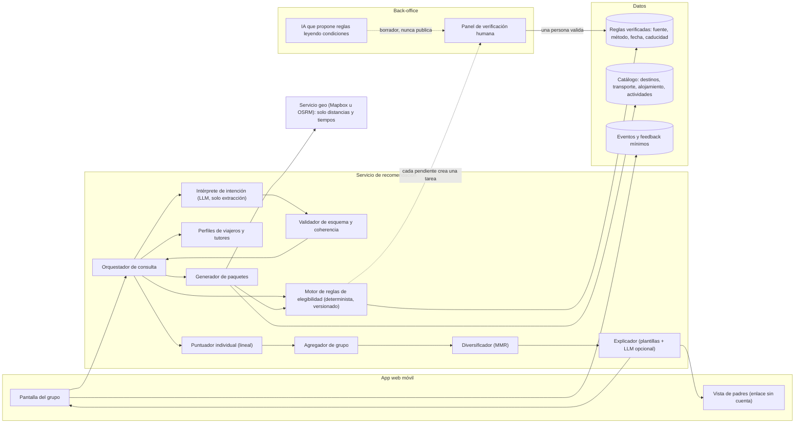
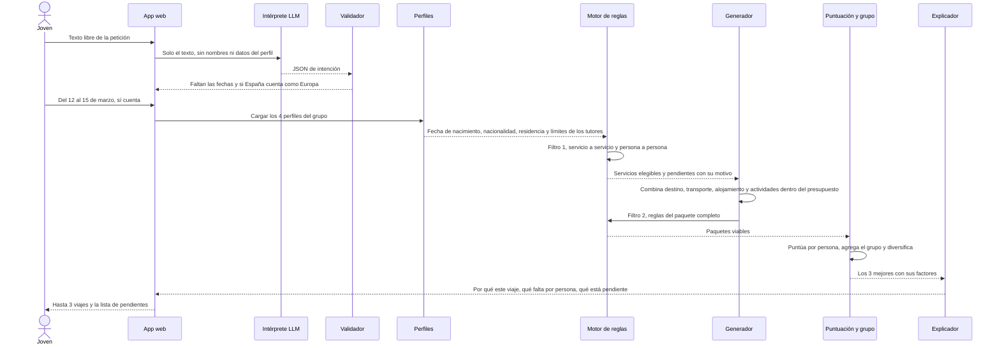
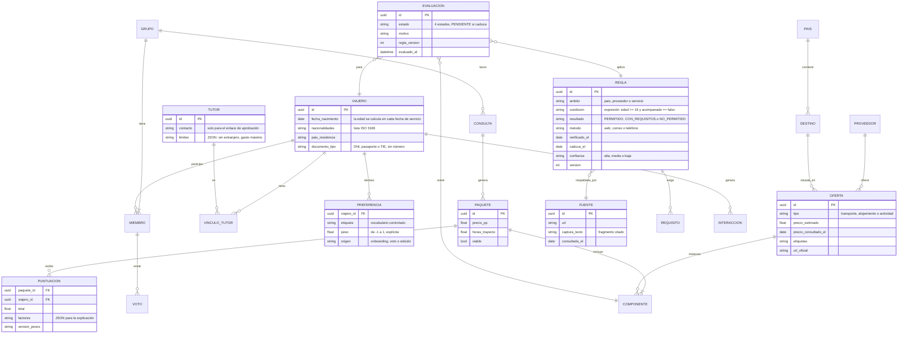

# Arquitectura del recomendador de GoLiveIt

> **Cómo leer las etiquetas de este documento.**
> - `CONFIRMADO`: lo dice una fuente pública que se cita con URL y fecha de consulta. Si la fuente es prensa o un agregador, se indica como `CONFIRMADO (secundaria)`; equivale a `SECUNDARIA` en la escala de D-02, y una fuente primaria equivale a `VERIFICADO`.
> - `INFERIDO`: es una deducción razonable a partir de lo que se observa, pero nadie lo ha dicho. Equivale a `INFERENCIA`.
> - `PROPUESTO`: es diseño nuestro para GoLiveIt. Equivale a `HIPÓTESIS` hasta que se valide.
>
> No se atribuye a Corner ninguna tecnología concreta (embeddings, LTR, grafos…) sin una fuente que lo diga.

## Resumen

1. **Sobre Corner** solo están confirmados *qué* hace, no *cómo* lo hace. Confirmado: usa IA y aprendizaje automático para analizar preferencias, intereses, ubicación y movimientos y recomendar lugares a partir del contenido de los usuarios; resume reseñas y genera descripciones con IA; tiene una búsqueda con IA en lenguaje natural que **solo devuelve lugares guardados por usuarios**, y la prensa dice que está construida sobre Claude, entre otros modelos. Todo lo demás es inferido: el filtrado colaborativo, los embeddings, el peso de la red social, el *learning to rank* o la diversificación.
2. **Nuestro problema es distinto.** Corner recomienda *lugares* para el día a día. GoLiveIt recomendaría *viajes completos* (destino × transporte × alojamiento × actividades) que un grupo concreto **puede hacer de verdad**. Por eso lo más importante del sistema no es el modelo de aprendizaje, sino un **motor de reglas de elegibilidad** que va antes de cualquier puntuación. Las políticas que no conocemos salen como **«pendiente de confirmar»**, nunca como «permitido».
3. **Arquitectura propuesta:** un modelo de lenguaje (LLM) que *solo* traduce la petición a datos estructurados → un validador → un **filtro duro** de elegibilidad persona a persona → la generación de paquetes → una puntuación lineal y transparente → una agregación de grupo («media sin miseria») → la diversificación → una explicación hecha con plantillas a partir de hechos.
4. **Recomendación para el MVP:** **no** hace falta personalización avanzada. Lo mínimo que demuestra valor es: «dados los perfiles del grupo, el presupuesto y las fechas, aquí tenéis hasta 3 viajes que podéis hacer, qué le falta a cada uno y un enlace para los padres». Los embeddings llegan cuando el catálogo crezca, y el *learning to rank*, cuando haya miles de interacciones etiquetadas.

---

## 1. Cómo podría funcionar el recomendador de Corner

### 1.1 Lo que está confirmado

| # | Afirmación | Fuente (consultada) | Etiqueta |
|---|---|---|---|
| C-1 | Usa «artificial intelligence and machine learning algorithms (or similar automated processing)» para **analizar preferencias o intereses y la ubicación o los movimientos**, y recomendar lugares «based on the User Content you provide» | Política de privacidad, versión 2026-10-01, <https://www.corner.inc/legal/privacy> (08/11/2026) | CONFIRMADO |
| C-2 | Usa IA para **sintetizar descripciones y categorizar información de reseñas** y para **generar contenido** (descripciones de lugares, selección de fotos); analiza imágenes de forma automática, pero dice que no hace reconocimiento facial | Ídem | CONFIRMADO |
| C-3 | Tiene un **agente de IA dentro de la app** y registra lo que buscas | Ídem | CONFIRMADO |
| C-4 | Usa los **contactos** para ver cuáles de ellos ya usan la app | Ídem; ficha de la App Store (contactos «usados para personalizar»), <https://apps.apple.com/app/id1668282277> (07/11/2026, según [[Corner]]) | CONFIRMADO |
| C-5 | La ficha de la tienda dice que **aprende tus gustos a partir de tus reseñas y tus guardados** | App Store (07/11/2026) | CONFIRMADO |
| C-6 | Hay una **búsqueda semántica** con IA («places to cowork from») que **solo devuelve lugares que han enviado usuarios de Corner**. El mapa tiene más de 275.000 lugares únicos guardados | B17 News, resumen de Business Insider, 18/09/2025, <https://b17news.com/these-founders-built-a-map-app-for-gen-z-to-discover-new-places-like-restaurants-and-shops-theyve-raised-3-8-million/> (08/11/2026) | CONFIRMADO (secundaria) |
| C-7 | La búsqueda está construida **sobre Claude de Anthropic y algunos modelos más**, y usa publicaciones de usuarios y metadatos públicos (Google, redes sociales, Resy) | Business Insider, julio de 2026. Solo lo hemos leído en el resumen de un buscador y en la bóveda; **no hemos podido abrir el artículo original** (Dealroom devolvió 403): <https://app.dealroom.co/news/feed/social-mapping-startup-corner-raises-7-5m-to-help-gen-z-find-restaurants-and-meet-up-irl> | CONFIRMADO (secundaria, sin leer el original) |
| C-8 | Las recomendaciones salen de las reseñas y del contenido publicado en la app y son «personalizadas para cada usuario, en vez de basarse en lo más popular». Tiene 250.000 usuarios en 425 ciudades | Jawlah, 22/07/2026, <https://jawlah.co/en/60830> (08/11/2026) | CONFIRMADO (secundaria) |
| C-9 | Mundo cerrado: «cada lugar tiene que añadirlo alguien que lo quiera lo bastante como para compartirlo» (Wu). La IA extrae «los detalles clave y la conexión emocional» con el lugar (Xia). Hay **etiquetas en tendencia** porque se ve «la primera ola» de gente que guarda un sitio | Apple, «Meet the Developer», <https://apps.apple.com/story/id1799046565> (08/11/2026) | CONFIRMADO (editorial de Apple) |
| C-10 | Una oferta de empleo de «AI Backend Engineer» describe una plataforma de lugares basada en una comprensión con IA de los lugares, su *vibe* y los usuarios que van | career.io, <https://career.io/job/ai-backend-engineer-new-york-corner-783b8a9b1d70e44d5f55d02dc8b53f01> (08/11/2026: la página no cargó; solo vimos el extracto del buscador) | CONFIRMADO (secundaria, débil) |

**Lo que no hemos encontrado en ninguna fuente:** el algoritmo de recomendación concreto, si usan embeddings o una base de datos vectorial, si tienen un modelo de *ranking* entrenado, cuánto pesan los amigos, o si diversifican los resultados.

### 1.2 Reconstrucción componente a componente

Cómo leer la columna «Experimento»: son pruebas **de caja negra con uso normal de la app**, compatibles con D-07 (nada de *scraping*, automatización ni ingeniería inversa). Debería hacerlas un miembro **adulto** del equipo con su cuenta real, porque la privacidad de Corner dice que el servicio no está dirigido a menores de 17. Antes de abrir una segunda cuenta de prueba hay que comprobar que las condiciones lo permiten. Cada prueba se anota con fecha en [[Corner]].

| Componente | Función que tendría en Corner | Qué lo apoyaría o lo descartaría | Etiqueta | Experimento que lo distinguiría |
|---|---|---|---|---|
| **Basado en contenido** | Recomendar lugares parecidos (categoría, etiquetas, *vibe* extraído de reseñas) a los que guardas o reseñas | **A favor:** C-2 (categoriza reseñas), C-5 (aprende de reseñas y guardados), C-9 (extrae «detalles clave»). **En contra:** que las recomendaciones no tengan relación de categoría o etiqueta con tus guardados | INFERIDO (muy probable) | Con una cuenta sin amigos, guardar 10 cafeterías de especialidad durante una semana. Si las recomendaciones se llenan de cafeterías y sitios con etiquetas parecidas, aunque no haya red social, el contenido está pesando |
| **Filtrado colaborativo** | «Gente que guardó lo que tú guardaste también guardó…» | **A favor:** C-8 («personalizadas, no lo más popular»); Beli, un competidor, dice usar gustos de usuarios parecidos (ver 1.3). **En contra:** que todo se explique por etiquetas o por amigos. **No hay declaración pública** | INFERIDO (posible) | Buscar recomendaciones **sin relación de contenido** con tus guardados (otra categoría, sin etiquetas comunes) que se repitan en cuentas con guardados parecidos. Es difícil de demostrar desde fuera: un resultado negativo no lo descarta |
| **Híbrido** | Combinar contenido, colaborativo, red social y ubicación | Es lo habitual en el sector (Burke, 2002; Foursquare publica una mezcla de señales, ver 1.3). Ninguna fuente de Corner lo dice | INFERIDO | Se deduce si los experimentos de contenido y de red social salen positivos a la vez. No es un experimento independiente |
| **Búsqueda semántica** | Entender «sitios tranquilos para estudiar» aunque las reseñas no usen esas palabras | **A favor:** C-6 (consultas semánticas), C-7 (LLM). **No se sabe** si la «semántica» la hacen embeddings, un LLM que reescribe la consulta o un LLM que reordena candidatos | CONFIRMADO (la función) · INFERIDO (la técnica) | Lanzar parejas de consultas parafraseadas sin palabras en común («sitio silencioso con enchufes» y «lugar para estudiar con portátil»), y la misma en español y en inglés. Mucho solapamiento → semántica real. Si responde con un texto redactado que cita reseñas, hay un LLM en la salida |
| **Embeddings vectoriales** | Representar lugares, reseñas y consultas como vectores para buscar por similitud | **A favor:** es la técnica estándar para la búsqueda semántica (Foursquare Ask API la describe, ver 1.3); C-10 habla de «comprensión con IA de los lugares». **En contra:** nada lo confirma; un LLM puede hacer el mismo papel sobre pocos candidatos | INFERIDO (probable, sin evidencia directa) | No se distingue bien desde fuera. Pista débil: los embeddings devuelven resultados «parecidos» aunque la consulta sea absurda o contradictoria. Un LLM que filtra suele decir «no hay» o explicar el conflicto |
| **Learning to rank** | Un modelo entrenado con clics y guardados que ordena los candidatos | **Ninguna evidencia.** Con 250.000 usuarios es viable, pero también lo es una puntuación a mano | INFERIDO (desconocido) | Desde fuera no se puede distinguir de una fórmula hecha a mano. Solo lo confirmaría una oferta de empleo o una charla de ingeniería |
| **Grafos o recomendación social** | Dar más peso a lo que guardan las personas a las que sigues o tus contactos | **A favor:** seguir y ver los sitios de amigos (App Store); los contactos «para personalizar» (C-4); «una recomendación de un amigo de confianza vale por 1.000 reseñas» (Wu, C-9). **No consta** que usen modelos de grafos (tipo PinSage) | CONFIRMADO (las señales sociales existen) · INFERIDO (que pesen en el *ranking*) | Seguir a un amigo que guarde 3 sitios concretos y poco conocidos de un barrio, y comparar el orden de las recomendaciones y búsquedas de ese barrio antes y después. Repetirlo dejando de seguirlo |
| **Representación de preferencias** | Un perfil del usuario: categorías, etiquetas propias, *vibe*, ubicación habitual | **A favor:** C-1 («preferencias o intereses»), etiquetas y notas propias en los guardados ([[Corner - análisis funcional]] §4). Si es un vector, unas etiquetas o ambas cosas: no consta | CONFIRMADO (que existe un perfil) · INFERIDO (su forma) | Comprobar si la app enseña o deja editar «tus gustos». Si no se puede, el perfil es implícito |
| **Señales sociales** | Popularidad, tendencia, guardados de amigos, reseñas | **A favor:** etiquetas en tendencia, «la primera ola de gente que lo guarda» (C-9), la actividad de amigos | CONFIRMADO (las señales existen) · INFERIDO (cuánto pesan) | Ver si un sitio que empieza a recibir guardados sube en «tendencia» antes de que salga en prensa. Solo es observable a lo largo de semanas |
| **Contexto geográfico** | Ordenar por cercanía, ciudad o movimientos | **A favor:** C-1 («ubicación o movimientos»), localización precisa y aproximada por IP, Google Maps para la ubicación (privacidad) | CONFIRMADO (se recoge y se usa para recomendar) | Hacer la misma consulta con el permiso de ubicación activado y desactivado, y desde dos barrios. Si el orden cambia con la distancia, la ubicación entra en el *ranking* |
| **Diversificación** | Evitar 10 resultados iguales (misma categoría o barrio) | Ninguna evidencia. Los filtros por colores y categorías (Apple) apuntan más a navegación que a diversificación automática | INFERIDO (desconocido) | Contar cuántas veces se repite la categoría en los 10 primeros resultados de una consulta amplia («qué hacer en Lisboa»). Si casi no se repite pese a un perfil muy sesgado, hay diversificación activa |
| **Arranque en frío** (*cold start*) | Recomendar a quien acaba de llegar | **A favor:** importar contactos (C-4), guardar enlaces de TikTok e Instagram, guías por ciudad y listas públicas ([[Corner - análisis funcional]] §3). Del lado de los lugares, no hay *cold start* de ítems: un lugar no existe hasta que alguien lo guarda (C-6, C-9) | CONFIRMADO (los mecanismos de entrada) · INFERIDO (que sirvan para resolver el *cold start*) | Abrir una cuenta nueva sin contactos y anotar qué recomienda el primer día: ¿lo popular de la ciudad, guías editoriales, algo personalizado? |
| ***Feedback* explícito e implícito** | Explícito: reseñas, guardados, listas, etiquetas. Implícito: búsquedas, uso, ubicación | **A favor:** C-5 (reseñas y guardados), C-3 (registra búsquedas), datos de uso vinculados (App Store) | CONFIRMADO (se recogen ambos) · INFERIDO (que el implícito entre en el modelo) | Hacer muchas búsquedas de un tema sin guardar nada y ver si las recomendaciones cambian. Si cambian, el *feedback* implícito pesa |
| **Resúmenes con IA** | Fichas de lugar con el «ambiente» resumido a partir de reseñas | C-2, C-9 | CONFIRMADO | — |
| **LLM en la búsqueda** | Interpretar la consulta o redactar la respuesta | C-7 (Claude, entre otros) | CONFIRMADO (secundaria) | — |

**Lectura crítica.** Corner puede permitirse un recomendador «de comportamiento» porque tiene uso **frecuente** y muchos usuarios (señales a diario). GoLiveIt tendría un uso **ocasional** (pocos viajes al año por persona), así que durante mucho tiempo **no habrá datos suficientes** para el filtrado colaborativo ni para el *learning to rank*. Lo que sí podemos copiar como principio es el **mundo cerrado**: Corner solo recomienda lugares que alguien ha guardado; nosotros, solo proveedores con la política para menores **verificada**.

### 1.3 Qué publican apps comparables (para no inventar)

| App | Qué publica | Qué nos enseña | Fuente |
|---|---|---|---|
| **Foursquare** | La portada personalizada puntuaba cada lugar mezclando novedad, distancia, afinidad de gustos, parecido con tus favoritos y actividad de amigos. Después mezclaba, ordenaba y **diversificaba**, y un servicio aparte elegía **una sola justificación personal** que enseñar. Las *tastes* son palabras clave extraídas de las reseñas. La Ask API traduce el lenguaje natural a conceptos con embeddings | Mezcla lineal de señales + diversificación + una razón por resultado: es casi nuestro MVP | <https://medium.com/foursquare-direct/personal-recommendations-for-the-foursquare-homescreen-3f0b4510b2a7> · <https://medium.com/foursquare-direct/exploring-the-foursquare-taste-map-52e743427001> · <https://foursquare.com/resources/blog/developer/introducing-the-foursquare-ask-api/> (08/11/2026) |
| **Airbnb** | Embeddings de alojamientos aprendidos de sesiones de clics (estilo *skip-gram*) para personalizar en tiempo real, más embeddings de tipo de usuario para las preferencias a largo plazo. Más tarde, redes neuronales para la búsqueda y *learning to rank* con diversidad | Los embeddings necesitan **cientos de millones** de sesiones. Lo que nos sirve es la idea, no la escala | Grbovic y Cheng, KDD 2018, <https://doi.org/10.1145/3219819.3219885>; blog: <https://medium.com/airbnb-engineering/listing-embeddings-for-similar-listing-recommendations-and-real-time-personalization-in-search-601172f7603e>; Haldar et al., KDD 2019, <https://arxiv.org/abs/1810.09591>; Abdool et al., «Learning to Rank Diversely at Airbnb», <https://arxiv.org/abs/2210.07774> |
| **Yelp** | Usa un LLM para **entender la consulta** (segmentarla) y para destacar fragmentos de reseñas. Precalcula en lote para abaratar | El LLM sirve para estructurar la petición, no para decidir. Precalcular abarata | <https://engineeringblog.yelp.com/2025/02/search-query-understanding-with-LLMs.html> (08/11/2026) |
| **Google Maps** | Gemini resume reseñas y responde a preguntas sobre un lugar **con fragmentos de reseñas reales y enlaces** | Toda respuesta generada va acompañada de su evidencia | <https://blog.google/products-and-platforms/products/maps/gemini-google-maps-navigation-updates/> (08/11/2026) |
| **Beli** | El usuario ordena restaurantes **por comparación de parejas** («¿te gustó más A o B?») y eso se convierte en una nota. Personaliza a partir de unos 15 restaurantes ordenados, usando gente de gustos parecidos (según prensa, no según Beli) | Comparar parejas es una forma barata de averiguar gustos en el arranque en frío | <https://tastecooking.com/beli-invites-the-loneliest-generation-to-dine-out/> (secundaria, 08/11/2026) |

---

## 2. Arquitectura propuesta para GoLiveIt

Todo lo de esta sección y las siguientes es `PROPUESTO`.

### 2.1 Principios no negociables

1. **La elegibilidad no se aprende ni se genera: se comprueba.** Un motor de reglas independiente y determinista decide, con reglas que son datos (fuente, método, fecha, caducidad), como en la [[Propuesta individual v0]] §6.
2. **Hay cuatro estados y uno es «no sé»:** `PERMITIDO` · `PERMITIDO_CON_REQUISITOS` · `NO_PERMITIDO` · `PENDIENTE_CONFIRMAR`. Una regla caducada o sin fuente pasa a `PENDIENTE_CONFIRMAR`. **Lo pendiente no se recomienda.**
3. **El filtro va antes de puntuar.** Ninguna puntuación, por alta que sea, compensa un «no permitido» o un «pendiente».
4. **Ni el LLM ni Mapbox son autoridad legal.** El LLM convierte texto en datos estructurados y redacta a partir de hechos. Mapbox (u otro servicio de mapas) solo calcula coordenadas, distancias y tiempos.
5. **La elegibilidad se evalúa persona a persona y servicio a servicio.** Depende de la edad **en la fecha de cada servicio** (alguien puede cumplir 18 a mitad del viaje), de la nacionalidad, de la residencia, de lo que permitan sus tutores y de las condiciones de cada país y proveedor.

### 2.2 Diagrama de componentes



### 2.3 Flujo de una consulta (el ejemplo)

Entrada: *«Somos cuatro amigos de 17 años, salimos de Sevilla, 250 € por persona, cuatro días, ciudad europea con ambiente joven, playa, actividades y alojamiento».*



### 2.4 Etapas en detalle

**Etapa 1. Interpretación (LLM solo para extraer).** El LLM recibe el texto y devuelve un JSON que se ajusta a un esquema cerrado:

```json
{
  "n_viajeros": 4, "edad_declarada": 17, "origen": "Sevilla",
  "presupuesto_pp_eur": 250, "incluye": ["transporte", "alojamiento", "actividades"],
  "duracion_dias": 4, "noches": 3, "fechas": null,
  "ambito": "Europa", "gustos": ["ambiente_joven", "playa", "actividades"],
  "dudas": ["fechas", "¿España cuenta como Europa?", "¿la comida entra en los 250 €?"]
}
```

El validador comprueba los tipos, los valores permitidos (los gustos salen de un vocabulario controlado), los rangos (presupuesto > 0, de 1 a 14 días) y la coherencia (4 días suponen 3 noches). Si faltan datos críticos, se pregunta al usuario, no se inventan. **La edad, la nacionalidad y la residencia nunca se toman del texto:** salen del perfil de cada persona, porque «tenemos 17» no dice si alguien cumple 18 en marzo ni si tiene otra nacionalidad. El texto pegado (por ejemplo, la descripción de un TikTok) se trata como **dato, no como instrucción**: es una defensa contra la inyección de *prompts*.

**Etapa 2. Filtro duro de elegibilidad (antes de puntuar).** Tiene dos pasadas:
- *Filtro 1, servicio a servicio:* para cada persona y cada servicio (salida de España, entrada al país, transporte, alojamiento, actividad) se evalúan las reglas y sale uno de los 4 estados con sus requisitos (por ejemplo, la declaración de permiso de viaje o la autorización firmada del alojamiento). Aquí también entran las restricciones de los tutores («no al extranjero», «máximo X €»).
- *Filtro 2, paquete completo:* reglas que dependen de la combinación. Por ejemplo: escalas no permitidas según la edad, llegar después de que cierre la recepción, alojamientos que exigen que haya un mayor de edad en el grupo, o un presupuesto que debe caber en el del miembro **que menos puede gastar**.
- Un paquete es viable solo si **todos** los servicios son `PERMITIDO` o `PERMITIDO_CON_REQUISITOS` **para todas las personas**. Lo `PENDIENTE_CONFIRMAR` no se ordena ni se recomienda: aparece aparte («podría servir si lo confirmamos») y **genera una tarea de verificación**. Así, cada consulta mejora la base (la ventaja que se acumula, [[Propuesta individual v0]] §5).

**Etapa 3. Generación de candidatos.** Destinos alcanzables desde el origen (con un tiempo máximo de trayecto) × las opciones de transporte elegibles × los alojamientos elegibles × un conjunto de actividades. En el MVP, con 30-50 proveedores, se pueden probar todas las combinaciones. Más adelante, para que no se disparen, se buscan primero los mejores componentes por coste y se combinan respetando el presupuesto (búsqueda en haz o *beam search*).

**Etapa 4. Puntuación individual.** Una suma lineal de pocos factores normalizados entre 0 y 1: ajuste al presupuesto, coincidencia de gustos, tiempo de trayecto, fricción (cuántos trámites necesita esa persona) y, cuando existan, señales sociales verificadas de otros jóvenes (H-13). Los pesos se fijan a mano y se publican (§5).

**Etapa 5. Agregación de grupo.** Primero se aplica la menor miseria como veto suave y luego la media (§4).

**Etapa 6. Diversificación.** Con MMR (*Maximal Marginal Relevance*: elegir lo mejor que no se parezca demasiado a lo ya elegido; Carbonell y Goldstein, 1998) entre los 3 primeros puestos, para que no sean tres versiones de la misma ciudad. Además, si la petición lo permite, se reserva un puesto a una **alternativa nacional**, que suele ser la que menos trámites tiene.

**Etapa 7. Explicación.** Una plantilla que se rellena con los factores calculados y el estado de cada regla (§5).

### 2.5 Cómo saldría el ejemplo (datos inventados para ilustrar)

> **Ficticio:** ni los precios ni los estados son datos reales. Sirve para ver la forma del resultado.

| Paquete | Precio por persona | ¿Pasa el filtro? | Motivo | Resultado |
|---|---|---|---|---|
| Lisboa: autobús + albergue + surf en Caparica | 228 € | Pendiente | Edad mínima del albergue sin fuente; autorización de Portugal sin aclarar (Q-20) | Aparte, como «pendiente de confirmar» + tarea de verificación |
| Lisboa: autobús + hotel que admite menores con autorización (verificado) + surf | 247 € | Sí, con requisitos | Autorización de los padres para el hotel y declaración de permiso de viaje para salir de España | **Recomendado n.º 1** |
| Oporto: autobús + albergue que solo admite mayores de 18 | — | No | El albergue exige 18 años | Descartado (se puede ver el motivo) |
| Niza: avión + albergue | 310 € | No | No cabe en 250 € | Descartado: «con 60 € más por persona sería posible» |
| Málaga: tren + albergue verificado + kayak | 190 € | Sí, con requisitos | Solo la autorización del albergue | **Recomendado n.º 2** (alternativa nacional) |

**Lo que enseña este ejemplo:** con 17 años y 250 €, el filtro duro **dejará muy pocas opciones internacionales**. Eso no es un fallo: es justo la información que hoy cuesta horas conseguir (H-05, H-11). El sistema tiene que decir con claridad **por qué no hay más** y **qué habría que cambiar** para que las hubiera.

### 2.6 Pseudocódigo (puntuación y agregación)

```text
PESOS = {presupuesto: .30, gustos: .35, tiempo: .15, friccion: .15, social: .05}
UMBRAL_MISERIA = 0.35          # nadie del grupo puede quedar por debajo

funcion puntuar(persona, paquete):                     # ya ha pasado el filtro duro
    f.presupuesto = 1 - paquete.precio_pp / persona.presupuesto_max   # 0 = justo
    f.gustos      = coincidencia_ponderada(persona.gustos, paquete.etiquetas)
    f.tiempo      = 1 - min(paquete.horas_trayecto / persona.horas_max, 1)
    f.friccion    = 1 - min(paquete.num_tramites(persona) / 4, 1)
    f.social      = paquete.valoracion_jovenes_verificada ?? 0.5      # neutro si no hay
    total = suma(PESOS[k] * f[k] para k en PESOS)
    devolver total, f                                  # f se guarda para explicar

funcion viable(grupo, paquete):
    para m en grupo.miembros:
        para s en paquete.servicios:
            e = motor_reglas.evaluar(m, s, edad_en=s.fecha)
            si e.estado no en {PERMITIDO, PERMITIDO_CON_REQUISITOS}: devolver falso
    devolver motor_reglas.evaluar_paquete(grupo, paquete).ok

funcion recomendar(grupo, paquetes, k=3):
    filas = []
    para p en paquetes:
        si no viable(grupo, p): continuar              # doble comprobación del filtro
        s = {m: puntuar(m, p).total para m en grupo.miembros}
        filas.añadir({p, media: media(s), minimo: min(s), por_persona: s})
    aceptables = [f para f en filas si f.minimo >= UMBRAL_MISERIA]
    si aceptables vacía:                               # conflicto fuerte de gustos
        aceptables = ordenar(filas, por minimo desc)   # menor miseria pura
        marcar_conflicto(grupo)                        # se explica y se propone votar
    devolver diversificar(ordenar(aceptables, por (media, minimo) desc), k)

funcion diversificar(filas, k, lambda=0.7):
    elegidos = []
    mientras len(elegidos) < k y filas:
        mejor = argmax(filas, f -> lambda * f.media
                       - (1 - lambda) * max(similitud(f.p, e.p) para e en elegidos, 0))
        elegidos.añadir(mejor); filas.quitar(mejor)
    devolver elegidos
```

---

## 3. Modelo de datos



Decisiones del modelo:
- **La fecha de nacimiento, no la edad.** La elegibilidad se evalúa en la fecha de cada servicio. Si no se quiere guardar la fecha completa, bastaría con el mes y el año más una comprobación del caso límite, pero eso complica las reglas.
- **Nunca se guarda el número de documento.** Para las reglas basta con saber el tipo de documento.
- **Las reglas y las evaluaciones tienen versiones.** Así se puede responder «¿por qué el 12/03 os dijimos que sí?» con la regla y la fuente de ese día.
- **Los precios son estimaciones con fecha.** El precio real se ve en la web del proveedor (MVP sin pagos propios).

---

## 4. Grupo y conflictos

### 4.1 Cómo se representan los gustos

- **Individuales:** un vector **pequeño y explícito** sobre un vocabulario controlado (por ejemplo: playa, ciudad, naturaleza, cultura, deporte, vida nocturna diurna, gastronomía, ritmo tranquilo o intenso), con pesos de -1 a 1 que el usuario **ve y edita**. Aparte, unos límites duros (presupuesto máximo, horas máximas de trayecto, cosas que no quiere de ninguna forma) que pasan al filtro duro y no a la puntuación.
- **De grupo:** **no se guarda un «gusto medio».** Se guardan los perfiles individuales y se agrega **en cada paquete** (agregar puntuaciones y no perfiles, como recomienda Masthoff), porque la media de «playa» y «montaña» no es un sitio que le guste a nadie.
- **Privacidad dentro del grupo:** los gustos de cada uno no se enseñan a los demás si no quiere. Al grupo se le dice «todos tenéis al menos un viaje que os encaja», no «a Pablo no le gusta».

### 4.2 Estrategias de agregación

| Estrategia | Cómo funciona | A favor | En contra | ¿Para GoLiveIt? |
|---|---|---|---|---|
| **Media** | Se ordena por la satisfacción media | Simple y estable | Puede elegir algo que alguien odia (9, 9, 9 y 1 empata con 7, 7, 7 y 7) | Como base, no sola |
| **Menor miseria** | Se ordena por el miembro menos satisfecho | Nadie queda fatal | La minoría manda; gana lo mediocre | Como **veto suave** (umbral) |
| **Media sin miseria** | Se descarta lo que deja a alguien por debajo de un umbral y se ordena por la media | Masthoff observó que se parece a cómo deciden las personas en grupo | Hay que fijar el umbral | **Recomendada** |
| **Votación (Borda, aprobación)** | Cada uno ordena o aprueba opciones y se suman los puntos | Participación visible y legitimidad | Se puede votar con estrategia; necesita interfaz | Después del motor, para elegir **entre las 3 propuestas** |
| **Justicia por turnos** | Si hoy ganó Ana, mañana pesa más Luis | Equidad a lo largo de una secuencia | Solo tiene sentido cuando hay una secuencia | **Dentro del viaje:** repartir las franjas de actividades de los 4 días |

**Recomendación razonada:**
1. **Lo duro es un veto.** Cualquier límite de una persona (presupuesto, permiso de sus padres, elegibilidad) filtra el paquete para **todo** el grupo. No es una opinión que se pueda compensar.
2. **Para elegir el viaje: media sin miseria.** Ningún miembro puede quedar por debajo de 0,35 y, entre lo que queda, se ordena por la media, con el mínimo como desempate. Encaja con lo que Masthoff observó en grupos reales y es fácil de explicar.
3. **Para decidir: el grupo vota.** Se enseñan 3 opciones diversas y cada uno las ordena (Borda). El voto es además el *feedback* explícito más valioso para fases futuras.
4. **Dentro del viaje: justicia por turnos.** Las 6-8 franjas de actividades se reparten para que cada miembro tenga al menos una de sus favoritas (la idea de Masthoff de satisfacer al grupo **a lo largo de una secuencia**).
5. **Si hay un conflicto fuerte** (ningún paquete supera el umbral), se dice: «vuestros gustos tiran hacia sitios distintos; estas son las opciones que menos le disgustan a cada uno» y se propone votar.

---

## 5. Explicaciones y transparencia

**Plantilla de «por qué este viaje»** (se genera a partir de los factores guardados, no lo inventa un LLM):

> **Lisboa, del 12 al 15 de marzo: 247 € por persona (estimado)**
> - **Os cabe:** os sobran 3 € del presupuesto del que menos tiene. Los precios se consultaron el dd/mm y pueden cambiar.
> - **Encaja con:** playa (Costa da Caparica, a unos 40 minutos según el servicio de mapas) y actividades (surf). No encaja tanto con «ambiente joven» porque el hotel está en una zona tranquila.
> - **Podéis ir los cuatro:** autobús: permitido desde 16 años sin adulto (verificado el dd/mm, [fuente]). Hotel: permitido **con autorización firmada de los padres** (verificado el dd/mm por correo). Surf: desde 16 años con autorización.
> - **Lo que falta, persona a persona:** 4 autorizaciones del hotel y 4 declaraciones de permiso de viaje para salir de España. Si alguien no tiene nacionalidad española, su lista puede ser distinta y se muestra solo a esa persona.
> - **Pendiente de confirmar:** nada en este plan. *(En otro plan: «edad mínima del albergue X: no tenemos fuente; no lo recomendamos hasta confirmarlo».)*

**Más reglas de transparencia:**
- **«Por qué no»**: cada paquete descartado se puede abrir y enseña su motivo y qué cambio lo haría posible: «+60 €», «si alguien del grupo tuviera 18», «otras fechas».
- **Cada estado lleva siempre su sello:** fuente, método, fecha y caducidad. «Pendiente» se ve en gris y no se puede añadir al plan que ven los padres (coherente con [[Funciones adaptadas de Corner]]).
- **Una página de «cómo ordenamos»** con los factores y sus pesos en lenguaje claro, y un interruptor **«ordenar sin personalización»** (por precio o por duración del trayecto) para quien no quiera que se usen sus gustos.
- **Si se usa un LLM para redactar**, solo puede reformular los hechos que recibe. Se comprueba automáticamente que cada cifra y cada estado del texto aparecen en los datos de entrada; si no, se usa la plantilla.

---

## 6. Arranque en frío y fases

### 6.1 Arranque en frío sin datos

| Problema | Solución sin datos de comportamiento |
|---|---|
| Usuario nuevo | **5 preguntas iniciales** (menos de un minuto): tipo de plan, ritmo, presupuesto máximo, horas máximas de trayecto y **3 comparaciones de parejas con fotos** («¿Lisboa o Málaga?», al estilo de Beli). Así se obtiene un vector inicial explícito |
| Destino o proveedor nuevo | **Contenido:** etiquetas puestas a mano por el equipo al verificarlo (playa, ambiente joven, a pie…). Las ponemos nosotros, así que no hay *cold start* de ítems: es el mundo cerrado verificado |
| Grupo nuevo | Los perfiles individuales ya bastan para agregar. Si alguien no ha contestado, cuenta como neutro (0,5) y se le avisa |
| Sin señales sociales | El peso social empieza en 0,05 con valor neutro. Las experiencias de jóvenes **solo** cuentan si son reales y están verificadas (en la demo están marcadas como inventadas) |

### 6.2 Evolución por fases (orientativa)

| Fase | Cuándo | Qué se añade | Qué NO cambia |
|---|---|---|---|
| **0. Manual** (MVP de la [[Propuesta individual v0]] §10) | Ahora, después de la fase 2 | Hoja de cálculo con reglas y etiquetas, un formulario y WhatsApp; el equipo aplica a mano la fórmula de §2.6 a 5-10 grupos reales | El filtro duro va primero |
| **1. Reglas + puntuación lineal** | Cuando la fase 0 demuestre demanda | Motor de reglas programado, puntuación lineal con pesos publicados, media sin miseria, MMR, plantillas de explicación, LLM solo para extraer | — |
| **2. Embeddings** | Catálogo de más de unos 200 servicios con descripciones, o muchas consultas en texto libre que el vocabulario no cubre | Embeddings de texto (multilingües) de las descripciones de destinos y actividades y de la consulta, para mejorar el factor **gustos** y la búsqueda («algo tipo Erasmus con playa») | Los embeddings **puntúan gustos; nunca deciden la elegibilidad** |
| **3. Learning to rank** | Cuando haya miles de consultas con etiquetas: plan guardado, votado, **enviado a los padres** y **aprobado** | Un modelo GBDT/LambdaMART que aprende a ordenar a partir de los factores de §2.6 y sustituye a los pesos hechos a mano. Se evalúa contra la fórmula lineal (§7) | Sigue después del filtro; se monitoriza el sesgo; la explicación usa los factores del modelo |

Por qué en este orden: con pocos viajes por usuario y año, el filtrado colaborativo y el LTR **no tienen datos**. Airbnb necesitó cientos de millones de sesiones para sus embeddings, y aun así empezó con modelos sencillos antes de pasar a redes neuronales (Haldar et al., 2019).

---

## 7. Evaluación

### 7.1 Offline (antes de enseñarlo)

| Qué se mide | Métrica | Objetivo |
|---|---|---|
| **Corrección de la elegibilidad** (lo más importante) | Batería de casos de referencia (perfil × servicio × fecha) revisados por una persona, con casos límite: cumple 18 durante el viaje, doble nacionalidad, residente no español, regla caducada | **0 falsos «permitido»**. Un «permitido» incorrecto bloquea el lanzamiento. Un «pendiente» de más es tolerable |
| Frescura de la base | % de reglas usadas que no han caducado; días medios desde la verificación | Más del 95 % de reglas vigentes en las consultas |
| Cobertura | % de consultas de prueba con al menos 1 paquete viable | Medirlo y explicarlo. Si es bajo, es información sobre el mercado, no un fallo del modelo |
| Calidad del orden | NDCG@3 contra el orden que dan 5-10 grupos de prueba a mano | Comparar la fórmula lineal con «ordenar por precio» (línea base) |
| Justicia en el grupo | Satisfacción mínima del grupo y desigualdad entre miembros (índice de Gini) | Que el mínimo no baje respecto a la media pura |
| Diversidad | Diversidad entre los 3 recomendados (destinos o tipos distintos) | Nunca 3 veces la misma ciudad |
| Explicaciones | % de explicaciones en las que cada cifra o estado coincide con los datos | 100 % |
| Extracción del LLM | Exactitud por campo sobre 100 peticiones reales anonimizadas | Más del 95 % en presupuesto, días y origen; si falla, se pregunta |
| Error de precio | Diferencia entre el precio estimado y el real al reservar | Medirla para ajustar el margen de seguridad |

### 7.2 Online (con usuarios reales)

- **Métrica principal (valor):** % de grupos que **envían el plan a sus padres** y % de esos planes que **se aprueban**, que es lo que miden H-11 y H-12. Después, viajes que de verdad se hacen.
- **Secundarias:** tiempo hasta tener un plan viable (comparado con lo que hoy declaran en J-P17), % de consultas con al menos un plan viable, votos de grupo completados.
- **Límites de seguridad:** quejas por información incorrecta (objetivo: 0), incidencias en las que un proveedor rechaza a alguien que dijimos que podía entrar, abandonos en las preguntas iniciales.
- **Experimentos A/B:** solo cuando haya tráfico. En las fases 0-1, con 5-10 grupos, sirven más las **pruebas cualitativas** (enseñar dos órdenes y preguntar cuál prefieren) que la estadística.

---

## 8. Riesgos y límites legales

> Esto no es asesoramiento jurídico: antes de lanzar hay que consultarlo (H-17, [[Marco legal del negocio]]).

### 8.1 Normas

| Norma | Qué dice (resumen) | Qué implica para el recomendador | Etiqueta |
|---|---|---|---|
| **DSA, art. 28.1** (Reglamento UE 2022/2065) | Las plataformas en línea accesibles a menores deben aplicar medidas adecuadas y proporcionadas para garantizar un nivel elevado de privacidad, seguridad y protección de los menores | Privacidad por defecto y recomendaciones prudentes | CONFIRMADO, <https://eur-lex.europa.eu/legal-content/ES/TXT/HTML/?uri=CELEX:32022R2065> (08/11/2026) |
| **DSA, art. 28.2** | **Prohíbe presentar anuncios basados en la elaboración de perfiles** (en el sentido del RGPD) con datos personales del destinatario cuando la plataforma sepa con certeza razonable que es menor | **Cero publicidad basada en perfiles.** Las ofertas de proveedores (comisiones, apartado 8 de la propuesta) nunca pueden ordenarse con el perfil del menor. Si hay contenido patrocinado, debe ir aparte, marcado y sin perfilado | CONFIRMADO (ídem) |
| **DSA, art. 28.3** | Cumplir con el art. 28 no obliga a tratar más datos personales para averiguar si alguien es menor | No hace falta pedir más datos para cumplir | CONFIRMADO (ídem) |
| **DSA, art. 19** | La sección 3 (arts. 19 a 28), **incluido el art. 28**, no se aplica a las plataformas que son **micro o pequeñas empresas** (salvo el art. 24.3), a no ser que sean «muy grandes» | **Matiz importante:** en sentido estricto, una startup pequeña probablemente quedaría exenta. Además, en el MVP quizá ni siquiera seamos una «plataforma en línea» (no difundimos contenido de usuarios al público); lo seríamos si publicamos reseñas de jóvenes (H-13). **Recomendación: cumplir el art. 28 de forma voluntaria desde el primer día**, porque es lo que esperan los padres y lo que exigirá la ley cuando crezcamos | CONFIRMADO (texto) · INFERIDO (cómo se nos aplica) |
| **Directrices de la Comisión sobre el art. 28** (14/07/2025) | Piden priorizar las **señales explícitas** de los menores frente a las de comportamiento y darles más control sobre lo que se les recomienda. Comentaristas jurídicos señalan que también piden una opción sin perfilado | Encaja con el diseño: gustos explícitos y editables, interruptor «sin personalización», nada de perfiles a partir de toda la actividad | CONFIRMADO, <https://digital-strategy.ec.europa.eu/en/library/commission-publishes-guidelines-protection-minors> (08/11/2026); texto: <https://eur-lex.europa.eu/legal-content/EN/TXT/?uri=OJ:C_202505519>. Lo de la opción sin perfilado es secundario: <https://www.hunton.com/privacy-and-cybersecurity-law-blog/european-commission-issues-guidelines-on-the-protection-of-minors> |
| **RGPD, art. 8** | En los servicios de la sociedad de la información ofrecidos directamente a menores, el consentimiento es válido desde los 16 años, y los Estados pueden bajarlo hasta los 13 | Se aplica cuando el tratamiento se basa en el consentimiento | CONOCIMIENTO PREVIO, <https://eur-lex.europa.eu/eli/reg/2016/679/oj> |
| **LOPDGDD, art. 7** | En España, los mayores de **14 años** pueden consentir por sí mismos el tratamiento de sus datos | Con 16-17 años pueden consentir. Aun así, la decisión de producto es **datos mínimos** e implicar a los padres (porque firman y pagan, no porque lo exija el consentimiento) | CONOCIMIENTO PREVIO, <https://www.boe.es/buscar/act.php?id=BOE-A-2018-16673> (pendiente de leer en el BOE, según [[Marco legal del negocio]]) |
| **RGPD, considerando 38, y arts. 22, 25 y 35** | Protección específica de los menores, sobre todo en mercadotecnia y perfiles; derecho a no ser objeto de decisiones solo automatizadas con efectos significativos; privacidad desde el diseño; evaluación de impacto | Un «no permitido» es información con su fuente, no una decisión jurídica nuestra, pero hay que explicar la lógica (§5). Como se tratan datos de menores y hay perfilado, **lo prudente es hacer la evaluación de impacto (EIPD)** antes de lanzar | CONOCIMIENTO PREVIO · INFERIDO (necesidad de EIPD) |

### 8.2 Riesgos técnicos y de producto

| Riesgo | Cómo se manifiesta | Mitigación |
|---|---|---|
| **«Permitido» falso** | Una regla mal copiada o caducada lleva a un menor a un albergue que no le admite | Estado «pendiente» por defecto, caducidad, validación humana, batería de casos límite, versiones, botón de «esto no es así» |
| **El LLM inventa** | Que extraiga 18 en vez de 17, o que redacte «está permitido» | El LLM no toca la elegibilidad; los datos personales salen del perfil; la explicación se contrasta con los datos |
| **Inyección de instrucciones** | El texto de un TikTok pegado incluye órdenes para el modelo | Se trata como dato; el esquema de salida es cerrado; el LLM no tiene herramientas con efectos |
| **Datos de menores enviados a terceros** | Mandar nombres o fechas de nacimiento al proveedor del LLM o de mapas | Al LLM solo va el texto de la petición. Al servicio de mapas, solo coordenadas de lugares, nunca la ubicación de la persona. Contrato de encargado del tratamiento y sin uso para entrenar |
| **Sesgo de popularidad** | Siempre salen Lisboa y Málaga porque son lo primero que verificamos | Diversificación, métrica de cobertura del catálogo y verificar en función de la demanda (las tareas de pendientes) |
| **Sesgo socioeconómico** | Con poco presupuesto «no hay nada» | Mostrar siempre la mejor alternativa viable (a menudo nacional) y lo que costaría la opción deseada |
| **Sesgo por nacionalidad o residencia** | Un amigo extranjero queda «excluido» y el grupo lo vive como culpa suya | Explicación privada a esa persona; al grupo se le dice «este destino tiene un requisito extra para un miembro» |
| **Perfilado excesivo** | Inferir gustos de toda la actividad | Solo señales explícitas en las fases 0-2; cuando llegue el LTR, la decisión sobre qué señales implícitas usar se revisa junto con la EIPD |
| **Contenido de riesgo** | Recomendar «ambiente joven» y que acabe siendo vida nocturna con alcohol | El vocabulario controlado no incluye etiquetas de alcohol para menores; las reglas de cada país (como en la demo v2) son información, no un reclamo |

---

## 9. Recomendación para el MVP

**¿Hace falta personalización avanzada en el MVP? No.** Por tres motivos:
1. **El valor que tenemos que demostrar no es «te conozco», es «puedes ir»** (H-11, H-12). Si el grupo recibe 3 viajes viables con lo que falta para cada uno y los padres los aprueban, la tesis se sostiene. Un orden más fino no cambia eso.
2. **No hay datos para aprender.** Con 5-10 grupos y un uso ocasional, el filtrado colaborativo, los embeddings entrenados o el LTR serían ruido caro.
3. **La parte difícil y defendible es la base verificada** (H-18, H-19). Cada hora invertida en el modelo es una hora menos verificando proveedores.

**Lo mínimo que demuestra valor** (fase 0, manual, respetando D-03):
- Entrada: un formulario con las preguntas de §6.1 + edad, nacionalidad y residencia de cada uno + fechas + presupuesto.
- Proceso: una hoja con las reglas verificadas (4 estados, fuente y fecha), el filtro aplicado a mano y la fórmula lineal de §2.6.
- Salida: **hasta 3 viajes**, cada uno con la explicación de §5, la lista de lo que falta por persona, lo que queda pendiente y **el enlace para los padres**.
- Éxito: que algún padre apruebe y pague una señal (Propuesta v0 §10), y medir las horas por proveedor verificado (H-18).

**Las 5 decisiones de diseño que no deben perderse al pasar a código:**
1. Filtro duro de elegibilidad, persona a persona y servicio a servicio, **antes** de puntuar. Las reglas son datos con fuente, fecha y caducidad.
2. Cuatro estados, y «pendiente de confirmar» **no se recomienda**; además, genera una tarea de verificación.
3. LLM solo para extraer y redactar a partir de hechos. Ni el LLM ni el servicio de mapas son fuente legal.
4. Grupo: los límites de cada uno son vetos, después media sin miseria, y la decisión final la toma el grupo votando.
5. Puntuación lineal, pocos factores, pesos publicados, opción «sin personalización» y explicación de «por qué sí» y «por qué no». Los embeddings y el LTR llegan cuando haya datos, y nunca deciden la elegibilidad.

---

## 10. Fuentes

Consultadas el 08/11/2026 salvo que se indique otra fecha.

**Corner**
- Política de privacidad de Corner, versión 2026-10-01: <https://www.corner.inc/legal/privacy>
- Ficha de la App Store: <https://apps.apple.com/app/id1668282277> (07/11/2026, ver [[Corner]])
- Apple, «Meet the Developer»: <https://apps.apple.com/story/id1799046565>
- B17 News, resumen de Business Insider (18/09/2025): <https://b17news.com/these-founders-built-a-map-app-for-gen-z-to-discover-new-places-like-restaurants-and-shops-theyve-raised-3-8-million/>
- Jawlah (22/07/2026): <https://jawlah.co/en/60830>
- Dealroom, ronda de 7,5 M$ (devolvió 403; la afirmación sobre Claude procede de Business Insider vía resumen de buscador y de la bóveda): <https://app.dealroom.co/news/feed/social-mapping-startup-corner-raises-7-5m-to-help-gen-z-find-restaurants-and-meet-up-irl>
- Oferta de empleo «AI Backend Engineer» (career.io, la página no cargó): <https://career.io/job/ai-backend-engineer-new-york-corner-783b8a9b1d70e44d5f55d02dc8b53f01>

**Apps comparables**
- Foursquare, «Personal recommendations for the Foursquare homescreen»: <https://medium.com/foursquare-direct/personal-recommendations-for-the-foursquare-homescreen-3f0b4510b2a7>
- Foursquare, «Exploring the Foursquare Taste Map»: <https://medium.com/foursquare-direct/exploring-the-foursquare-taste-map-52e743427001>
- Foursquare, Ask API: <https://foursquare.com/resources/blog/developer/introducing-the-foursquare-ask-api/>
- Yelp Engineering, «Search query understanding with LLMs» (02/2025): <https://engineeringblog.yelp.com/2025/02/search-query-understanding-with-LLMs.html>
- Google, «New in Maps: Inspiration curated with Gemini»: <https://blog.google/products-and-platforms/products/maps/gemini-google-maps-navigation-updates/>
- Airbnb Engineering, «Listing embeddings in search ranking»: <https://medium.com/airbnb-engineering/listing-embeddings-for-similar-listing-recommendations-and-real-time-personalization-in-search-601172f7603e>
- TASTE, sobre Beli (secundaria): <https://tastecooking.com/beli-invites-the-loneliest-generation-to-dine-out/>

**Literatura**
- Masthoff, J. (2011). «Group Recommender Systems: Combining Individual Models». *Recommender Systems Handbook*, Springer: <https://doi.org/10.1007/978-0-387-85820-3_21>
- Masthoff, J. (2004). «Group Modeling: Selecting a Sequence of Television Items to Suit a Group of Viewers». *UMUAI* 14: <https://doi.org/10.1023/B:USER.0000010138.79319.fd>
- Jameson, A. y Smyth, B. (2007). «Recommendation to Groups». *The Adaptive Web*: <https://doi.org/10.1007/978-3-540-72079-9_20>
- Grbovic, M. y Cheng, H. (2018). «Real-time Personalization using Embeddings for Search Ranking at Airbnb». KDD: <https://doi.org/10.1145/3219819.3219885>
- Haldar, M. et al. (2019). «Applying Deep Learning to Airbnb Search». KDD: <https://arxiv.org/abs/1810.09591>
- Abdool, M. et al. «Learning to Rank Diversely at Airbnb»: <https://arxiv.org/abs/2210.07774>
- Burges, C. (2010). «From RankNet to LambdaRank to LambdaMART: An Overview». MSR-TR-2010-82: <https://www.microsoft.com/en-us/research/publication/from-ranknet-to-lambdarank-to-lambdamart-an-overview/>
- Liu, T.-Y. (2009). «Learning to Rank for Information Retrieval». *FnTIR*: <https://doi.org/10.1561/1500000016>
- Burke, R. (2002). «Hybrid Recommender Systems: Survey and Experiments». *UMUAI*: <https://doi.org/10.1023/A:1021240730564>
- Hu, Y., Koren, Y. y Volinsky, C. (2008). «Collaborative Filtering for Implicit Feedback Datasets». ICDM: <https://doi.org/10.1109/ICDM.2008.22>
- Schein, A. et al. (2002). «Methods and Metrics for Cold-Start Recommendations». SIGIR: <https://doi.org/10.1145/564376.564421>
- Ying, R. et al. (2018). «Graph Convolutional Neural Networks for Web-Scale Recommender Systems» (PinSage). KDD: <https://arxiv.org/abs/1806.01973>
- Carbonell, J. y Goldstein, J. (1998). «The Use of MMR, Diversity-Based Reranking…». SIGIR: <https://doi.org/10.1145/290941.291025>
- Ziegler, C.-N. et al. (2005). «Improving Recommendation Lists Through Topic Diversification». WWW: <https://doi.org/10.1145/1060745.1060754>
- Tintarev, N. y Masthoff, J. (2007). «A Survey of Explanations in Recommender Systems». ICDE Workshops: <https://doi.org/10.1109/ICDEW.2007.4401070>

**Normativa**
- Reglamento (UE) 2022/2065 (DSA), arts. 19 y 28, en español: <https://eur-lex.europa.eu/legal-content/ES/TXT/HTML/?uri=CELEX:32022R2065>
- Comisión Europea, directrices sobre la protección de menores, art. 28 DSA (14/07/2025): <https://digital-strategy.ec.europa.eu/en/library/commission-publishes-guidelines-protection-minors> · texto: <https://eur-lex.europa.eu/legal-content/EN/TXT/?uri=OJ:C_202505519>
- Hunton Andrews Kurth, resumen de las directrices (22/07/2025): <https://www.hunton.com/privacy-and-cybersecurity-law-blog/european-commission-issues-guidelines-on-the-protection-of-minors>
- Reglamento (UE) 2016/679 (RGPD): <https://eur-lex.europa.eu/eli/reg/2016/679/oj>
- Ley Orgánica 3/2018 (LOPDGDD): <https://www.boe.es/buscar/act.php?id=BOE-A-2018-16673>
