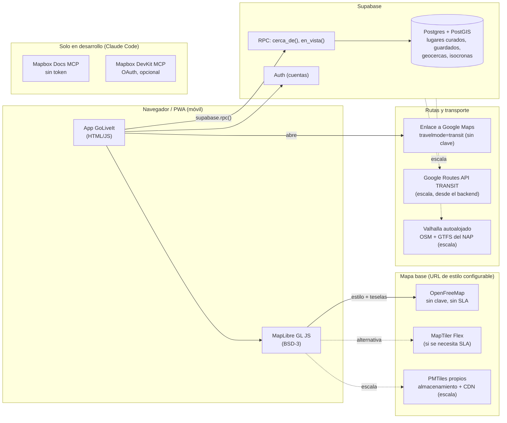

# Investigación: Mapbox, MCP y alternativas de mapas para GoLiveIt

**Etiquetas de fiabilidad.** **VERIFICADO**: leído hoy (08/11/2026) en la fuente oficial (docs, repositorio o página de precios del proveedor). **SECUNDARIA**: viene de un buscador, un agregador o un resumen de terceros. **INFERIDO**: deducción propia o conocimiento previo que no he vuelto a leer hoy. Los precios están en USD salvo que se diga otra cosa y **cambian a menudo**: hay que mirarlos otra vez antes de presentarlos.

**Entorno comprobado.** Windows 11, Node 26, Claude Code CLI y un único MCP configurado (REA). No hay MCP de Mapbox, ni `MAPBOX_ACCESS_TOKEN`, ni PostgreSQL/PostGIS, ni Docker. Para hacer este documento no se ha instalado nada, ni creado cuentas, ni tocado la configuración.

---

## Resumen y recomendación

1. **Mapbox no es imprescindible en ninguna fase. En el MVP conviene una base abierta: MapLibre GL JS + teselas OSM.** MapLibre tiene licencia BSD-3 y no pide clave (VERIFICADO). OpenFreeMap da teselas gratis, sin registro y sin clave, con el estilo `https://tiles.openfreemap.org/styles/liberty` (VERIFICADO). Mapbox es la mejor opción si el equipo quiere el acabado visual más cuidado (estilo Standard, 3D, Studio). Su nivel gratuito es generoso: 50 000 cargas de mapa al mes y 100 000 peticiones de Directions o Isochrone (VERIFICADO). A cambio, la licencia es propietaria, hace falta un token y quedamos atados al proveedor.
2. **Ningún proveedor de mapas base cubre lo que más necesita GoLiveIt: horarios de tren, bus y vuelo.** Mapbox Directions solo ofrece `driving-traffic`, `driving`, `walking` y `cycling`, sin transporte público (VERIFICADO). Las opciones reales son estas:
   - **Google Routes API** con `travelMode: TRANSIT` (VERIFICADO).
   - **Transitous/MOTIS**: gratis, pero **solo para proyectos no comerciales y de código abierto** (VERIFICADO).
   - **Motor propio con GTFS** del Punto de Acceso Nacional (SECUNDARIA).
   - Para la demo y el MVP basta un **enlace profundo a Google Maps** en modo transporte público, que no necesita clave (VERIFICADO).
3. **Demo actual.** Dentro del artefacto de claude.ai **no puede cargarse ninguna tesela externa**, ni de Mapbox ni de OSM. Ahí la solución es MapLibre desde cdnjs con fronteras GeoJSON incrustadas y marcadores propios. El HTML local o publicado en un hosting sí puede usar OpenFreeMap sin clave. `70 Prototipo/planner.src.html` ya hace esto bien, con tres modos: sin conexión, OpenFreeMap y Mapbox con token `pk.`. Falta un detalle de atribución (ver §3.1).
4. **MVP.** MapLibre y OpenFreeMap, con la URL de estilo configurable para cambiar a MapTiler o a PMTiles propios. Los lugares los cura el equipo y se guardan en Supabase con PostGIS. Esa base propia es el valor del producto (lugares adecuados y legales para 16-17 años) y además evita las restricciones de almacenamiento de Mapbox y Google. El transporte público, por enlace profundo. **PostGIS no hace falta para la demo.** En el MVP es útil, pero no obligatorio, mientras haya menos de unos miles de lugares.
5. **A escala.** Teselas propias en PMTiles sobre un CDN, o un plan de pago de MapTiler o Stadia. Valhalla (MIT) autoalojado para rutas a pie y multimodales con GTFS. Google Routes para transporte público fuera de la cobertura propia. PostGIS gestionado.
6. **Los MCP de Mapbox valen para desarrollar, no para el producto.** El **Docs MCP** es gratis, no pide token y conviene añadirlo ya: mejora la calidad del código Mapbox que se genere. El **DevKit MCP** solo merece la pena si se usa Mapbox Studio y estilos propios. Es preferible su versión alojada con OAuth, que no deja ningún token en disco. Ojo: puede **borrar estilos** (`delete_style_tool`, marcada como destructiva).
7. **Aviso legal práctico.** Las condiciones de OpenFreeMap exigen que quien integre el servicio sea **mayor de 18 años** (VERIFICADO). Las cuentas de proveedores (Mapbox, Google, Supabase, OpenFreeMap) deben ir a nombre de un miembro adulto del equipo, no de los de 16-17 años. INFERIDO: las condiciones de edad de Mapbox y Google no se han revisado hoy.

---

## 1. Mapbox DevKit MCP Server

Repositorio: <https://github.com/mapbox/mcp-devkit-server> · Documentación: <https://docs.mapbox.com/location-ai/mcp-servers/devkit-mcp-server/> (ambos VERIFICADO, 08/11/2026).

### 1.1 Qué es

Es un servidor MCP «para desarrolladores» que da a un asistente acceso a las API de desarrollo de Mapbox: gestión de estilos, tokens, feedback de usuarios y utilidades de GeoJSON. **No sirve para buscar sitios ni calcular rutas.** Eso lo hace el otro servidor, el *Mapbox MCP Server* (`mapbox/mcp-server`, ver §1.8). VERIFICADO.

- Paquete npm: `@mapbox/mcp-devkit-server` **v0.9.0**, licencia **MIT**, binario `mapbox-mcp-devkit`, requiere **Node ≥ 22** (VERIFICADO, `package.json`). Node 26 cumple.
- Dependencias principales: `@modelcontextprotocol/server` y `@modelcontextprotocol/core` ^2.4, `@modelcontextprotocol/ext-apps` (MCP Apps, para vistas previas interactivas), `@mcp-ui/server`, `@mapbox/mapbox-gl-style-spec` ^14.26, `zod` ^4 y OpenTelemetry (trazas, desactivadas por defecto). VERIFICADO.

### 1.2 Herramientas exactas

El código registra **23 herramientas** en `src/tools/toolRegistry.ts`, todas en `CORE_TOOLS` (VERIFICADO). Las clases y sus carpetas están verificadas. Los nombres MCP siguen el patrón `snake_case_tool`: `delete_style_tool` y `create_token_tool` están **VERIFICADO** en el código, y el resto es **INFERIDO** por ese patrón y por el README.

| Herramienta (clase) | Nombre MCP | Qué hace | Alcance (scope) necesario | ¿Llama a la API? |
|---|---|---|---|---|
| ListStylesTool | `list_styles_tool` (INF.) | Lista los estilos de la cuenta, paginados | `styles:list` | Sí |
| CreateStyleTool | `create_style_tool` (INF.) | Crea un estilo | `styles:write` | Sí |
| RetrieveStyleTool | `retrieve_style_tool` (INF.) | Descarga la especificación completa de un estilo | `styles:download` | Sí |
| UpdateStyleTool | `update_style_tool` (INF.) | Cambia el nombre o la especificación | `styles:write` | Sí |
| **DeleteStyleTool** | **`delete_style_tool`** (VER.) | **Borra un estilo** (`DELETE styles/v1/{user}/{id}`). Anotación `destructiveHint: true` | `styles:write` | Sí |
| PreviewStyleTool | `preview_style_tool` (VER. en docs) | URL de vista previa. Por defecto crea un token de vista previa de corta duración; con `share: true` usa un token público existente | `tokens:read` + un token público con `styles:read` | Sí |
| StyleBuilderTool | `style_builder_tool` (INF.) | Crea o modifica estilos a partir de instrucciones | — | No (genera JSON) |
| StyleComparisonTool | `style_comparison_tool` (VER. en README) | Compara estilos visualmente | Probablemente lectura de estilos (INF.) | Sí |
| CompareStylesTool | `compare_styles_tool` (VER. en README) | Diferencias entre dos estilos en JSON | — | No |
| OptimizeStyleTool | `optimize_style_tool` (INF.) | Quita redundancias de un estilo | — | No |
| ValidateStyleTool | `validate_style_tool` (INF.) | Valida el JSON de un estilo sin conexión | — | No |
| ValidateExpressionTool | `validate_expression_tool` (INF.) | Valida expresiones de estilo | — | No |
| ValidateGeojsonTool | `validate_geojson_tool` (INF.) | Valida GeoJSON | — | No |
| GeojsonPreviewTool | `geojson_preview_tool` (VER. en README) | Devuelve una URL de geojson.io (beta). Con archivos grandes la URL sale enorme | — | No (pero **sube los datos en la URL**) |
| **CreateTokenTool** | **`create_token_tool`** (VER.) | Crea un **token público**. Los scopes se limitan por código a `styles:tiles`, `styles:read`, `fonts:read`, `datasets:read` y `vision:read`. Admite hasta 100 `allowedUrls` y un `expires` opcional | `tokens:write` | Sí |
| ListTokensTool | `list_tokens_tool` (INF.) | Lista tokens con filtros | `tokens:read` | Sí |
| ListFeedbackTool / GetFeedbackTool | `list_feedback_tool` / `get_feedback_tool` (VER. en README) | Lee las correcciones de mapa que han enviado los usuarios | `user-feedback:read` | Sí |
| TilequeryTool | `tilequery_tool` (INF.) | Consulta las entidades de las teselas en un punto (API Tilequery) | Token válido (INF.) | Sí |
| BoundingBoxTool / CountryBoundingBoxTool | (INF.) | Caja envolvente de una geometría o de un país | — | No |
| CoordinateConversionTool | (INF.) | Convierte entre EPSG:4326 y 3857 | — | No |
| CheckColorContrastTool | (INF.) | Contraste WCAG 2.1 | — | No |

Además ofrece:

- **Recursos** de referencia: `resource://mapbox-style-layers`, `mapbox-streets-v8-fields`, `mapbox-token-scopes` y `mapbox-layer-type-mapping`.
- **Prompts**: `create-and-preview-style`, `build-custom-map`, `analyze-geojson`, `setup-mapbox-project`, `debug-mapbox-integration`, `design-data-driven-style` y `prepare-style-for-production`.

VERIFICADO (README).

### 1.3 Instalación

| Vía | Cómo | Credencial | Notas |
|---|---|---|---|
| **Alojado (recomendado)** | `https://mcp-devkit.mapbox.com/mcp` (HTTP) | **OAuth en el navegador** la primera vez. No hay token en disco | **Sin `create_token_tool` ni prompts MCP** (VERIFICADO, docs) |
| npx | `npx -y @mapbox/mcp-devkit-server` | `MAPBOX_ACCESS_TOKEN` (token `sk.`) | Todas las herramientas |
| Docker | `docker build -t mapbox-mcp-devkit .` y luego `docker run -i --rm -e MAPBOX_ACCESS_TOKEN=… mapbox-mcp-devkit` | Token | Aquí no hay Docker: descartado |
| Compilación local / DXT | `npm run build` y `node dist/esm/index.js`, o empaquetado `.dxt` | Token | Solo si se quiere modificar el servidor |

Variables opcionales: `VERBOSE_ERRORS=true` para ver errores detallados y `ENABLE_MCP_UI=false` (o `--disable-mcp-ui`) para desactivar las vistas MCP-UI. VERIFICADO.

### 1.4 Cómo añadirlo a Claude Code

Comandos oficiales (VERIFICADO, docs de Mapbox):

```bash
# Alojado (OAuth)
claude mcp add --transport http mapbox-devkit-mcp https://mcp-devkit.mapbox.com/mcp

# npm (stdio)
claude mcp add --transport stdio MapboxDevKitServer -- npx -y @mapbox/mcp-devkit-server
```

**Versión adaptada a nuestro caso**, siguiendo la sintaxis oficial de Claude Code (VERIFICADO en <https://code.claude.com/docs/en/mcp>): las opciones van antes del nombre, después `--`, y `-s/--scope` acepta `local` (por defecto), `project` o `user`.

```bash
# Opción A, recomendada: alojado con OAuth, ámbito de usuario
claude mcp add --transport http --scope user mapbox-devkit https://mcp-devkit.mapbox.com/mcp
#   y después, dentro de Claude Code: /mcp → mapbox-devkit → autenticar en el navegador

# Opción B: local con token secreto (solo si hace falta create_token_tool o los prompts)
claude mcp add --env MAPBOX_ACCESS_TOKEN=sk.TU_TOKEN --transport stdio --scope user mapbox-devkit -- npx -y @mapbox/mcp-devkit-server
```

- En la opción B, `--env` **no puede ir justo antes del nombre**: la CLI leería el nombre como otro par `CLAVE=valor`. Por eso `--transport` va en medio (VERIFICADO).
- Si en Windows nativo el servidor no arranca con `npx`, se puede probar `-- cmd /c npx -y @mapbox/mcp-devkit-server` (INFERIDO: la página actual de Claude Code no lo menciona).
- **Ámbito.** `user` se guarda en `~/.claude.json` y está disponible en todos los proyectos. `project` escribe `.mcp.json` en la raíz del repositorio y **se sube a Git**. Nunca debe usarse `project` con un token en claro. Con la opción A no hay ningún secreto, así que podría compartirse por `project`, pero cada miembro tendría que autenticarse con su propia cuenta.
- Con la opción B, **el token queda en texto plano en `~/.claude.json`** (INFERIDO por cómo funciona `--env`).

### 1.5 Credenciales y scopes

Scopes que pide cada grupo de herramientas (VERIFICADO, docs DevKit):

- Estilos: `styles:list`, `styles:read`, `styles:download`, `styles:write`.
- Tokens: `tokens:read`, y `tokens:write` para `create_token_tool`.
- Feedback: `user-feedback:read`.
- Vista previa: `tokens:read` más al menos un token público con `styles:read`.

`styles:list`, `styles:write`, `tokens:read` y `tokens:write` son **scopes secretos**, así que hace falta un token `sk.` (VERIFICADO, guía de tokens).

**Token mínimo para GoLiveIt** (INFERIDO, a partir de la tabla de §1.2):

| Uso | Scopes |
|---|---|
| Solo lectura, revisar estilos y validar | `styles:list`, `styles:read`, `styles:download`, `tokens:read` |
| Además, crear o editar estilos | Añadir `styles:write`. **También permite borrarlos** |
| Además, crear tokens públicos desde el asistente | Añadir `tokens:write`. Desaconsejado: mejor crearlos a mano en la consola |

Un token no puede crear otro con más scopes de los que tiene (VERIFICADO).

### 1.6 Qué hace con estilos y tokens: riesgos

- **Estilos: los puede crear, leer, modificar y BORRAR.** El borrado es una llamada `DELETE` directa. El README no avisa de que no se puede deshacer, y no hay papelera documentada (VERIFICADO / INFERIDO). Mitigaciones:
  1. Usar un token sin `styles:write` mientras no haga falta.
  2. Bloquear `mcp__mapbox-devkit__delete_style_tool` en los permisos de Claude Code. El usuario decidiría ese cambio de configuración.
  3. Exportar los estilos importantes (JSON) a la bóveda antes de editarlos.
- **Tokens: los puede crear y listar, no borrarlos ni rotarlos** (VERIFICADO). `create_token_tool` solo crea tokens **públicos** (lista cerrada de scopes en el código). El límite de una hora de `expires` aparece en la descripción, pero el esquema no lo impone (VERIFICADO en el código). INFERIDO: el riesgo es acumular tokens públicos sin restricción de URL si el asistente los crea sin `allowedUrls`.
- **`list_tokens_tool`** devuelve los tokens de la cuenta al contexto del modelo. Tratarlos como sensibles (INFERIDO).
- **`geojson_preview_tool`** mete los datos en una URL de geojson.io, un tercero. No debe usarse con datos de usuarios (INFERIDO).
- **Cuentas de prueba (trial):** traen un solo token y **no pueden crear, rotar ni borrar tokens hasta añadir un método de pago** (VERIFICADO, guía de tokens). Puede impedir la opción B y la restricción de URL (§8) hasta que alguien adulto añada una tarjeta.

### 1.7 Límites y costes

El README y la documentación del DevKit **no indican precios ni límites propios** (VERIFICADO: no aparecen). Las herramientas que llaman a la API consumen de la cuenta como cualquier otra petición: Styles, Tokens, Tilequery y Feedback. Las de gestión de estilos y tokens no tienen precio en la página oficial (INFERIDO: no son facturables, o son marginales). Las herramientas sin conexión no consumen nada.

### 1.8 Servidores relacionados

- **Mapbox MCP Server** (`mapbox/mcp-server`, alojado en `https://mcp.mapbox.com/mcp`). Herramientas que **sí llaman a API facturables**: `directions_tool`, `isochrone_tool`, matrix, `search_and_geocode_tool`, `category_search_tool`, `reverse_geocode_tool`, `static_map_image_tool`, optimization y map matching. También trae herramientas geométricas sin conexión basadas en Turf (`distance_tool`, `union_tool`…). Pide token (VERIFICADO). Sirve para prototipar consultas de rutas y lugares desde el chat. Sus resultados heredan las restricciones de almacenamiento (§3.2).

---

## 2. Mapbox Docs MCP y Mapbox Agent Skills

### 2.1 Docs MCP Server

Fuentes: <https://github.com/mapbox/mcp-docs-server> y <https://docs.mapbox.com/location-ai/mcp-servers/docs-mcp-server/> (VERIFICADO).

- **Qué es:** búsqueda de texto completo en la documentación de Mapbox y descarga de páginas enteras. Licencia MIT.
- **Herramientas:**
  - `search_mapbox_docs_tool`: 5 resultados por defecto, máximo 20.
  - `get_document_tool`: solo URL de `mapbox.com` o `docs.tilestream.net`.
  - `batch_get_documents_tool`: hasta 20 páginas por llamada.
  - Además, 8 recursos de referencia.
- **Token: no hace falta.** La guía lo dice así, aunque sus ejemplos de npm siguen poniendo `MAPBOX_ACCESS_TOKEN`, una incoherencia de la propia documentación. **Coste: no figura.**
- **Instalación:**

```bash
claude mcp add --transport http --scope user mapbox-docs https://mcp-docs.mapbox.com/mcp     # alojado
claude mcp add --transport stdio --scope user mapbox-docs -- npx -y @mapbox/mcp-docs-server  # local
```

### 2.2 Mapbox Agent Skills

Fuentes: <https://github.com/mapbox/mapbox-agent-skills> y <https://docs.mapbox.com/location-ai/agent-skills/> (VERIFICADO).

- **Qué son:** 20 *skills* (carpetas con `SKILL.md`). Son **conocimiento, no código ni herramientas**, con licencia MIT. Las que más nos sirven:
  - `mapbox-maplibre-migration`: pasar de Mapbox GL JS a MapLibre y al revés.
  - `mapbox-web-performance-patterns`
  - `mapbox-data-visualization-patterns`: clustering, heatmaps.
  - `mapbox-cartography`
  - `mapbox-store-locator-patterns`: es el patrón de un buscador de lugares como el nuestro.
  - `mapbox-search-integration`
  - `mapbox-token-security`
  - `mapbox-geospatial-operations`
  - `mapbox-style-quality`
- **Instalación en Claude Code:**
  - Plugin oficial: `/plugin marketplace add mapbox/mapbox-agent-skills` y luego `/plugin install mapbox`. **Ojo:** el `.mcp.json` del plugin **conecta además los tres servidores alojados**: `mapbox-devkit` (`mcp-devkit.mapbox.com`), `mapbox` (`mcp.mapbox.com`, que consume API facturables) y `mapbox-docs` (VERIFICADO, `.mcp.json` del repositorio).
  - CLI de skills: `npx skills add mapbox/mapbox-agent-skills`, con `--list` para ver la lista o `--skill <nombre>` para instalar una sola.
  - A mano: clonar el repositorio y copiar `skills/*` a `~/.claude/skills/`.
- **Token:** no hace falta para cargarlas. Sí para ejecutar lo que generen contra Mapbox (INFERIDO).

### 2.3 Cómo mejorarían nuestras demos (INFERIDO)

- **Docs MCP:** el asistente consulta la versión vigente de la API en vez de recordar parámetros de memoria. Evita errores típicos: nombres de capas de Streets v8, parámetros de Search Box, límites de Isochrone.
- **Skills `maplibre-migration` y `web-performance-patterns`:** encajan con la recomendación de usar MapLibre y dejan la puerta abierta a volver a Mapbox sin reescribir.
- **`store-locator-patterns` y `data-visualization-patterns`:** patrones probados de marcadores, clustering y fichas, la parte visual más vistosa de GoLiveIt.
- **`token-security`:** una lista de comprobación para no publicar un `sk.` por error.
- **Recomendación:** instalar solo el Docs MCP y, si se quiere, 3 o 4 skills sueltas con `--skill`, **no el plugin completo**. Así no se conecta `mcp.mapbox.com` y no se generan consumos sin darse cuenta. La decisión y la instalación son del usuario.

---

## 3. API de Mapbox

### 3.1 Mapbox GL JS

- **Versión actual:** `mapbox-gl` **3.34.2** en npm (VERIFICADO, registro de npm).
- **Licencia:** desde la v2 (diciembre de 2020) **no es de código abierto**. El repositorio dice que está *«licensed under the Mapbox TOS for use only with the relevant Mapbox product(s)»* y que la licencia termina si la cuenta deja de estar al corriente (VERIFICADO, GitHub). MapLibre GL JS nació como fork de la rama 1.x, que sí era abierta (VERIFICADO, GitHub de MapLibre).
- **Facturación por *map loads*:** cuenta cada vez que se inicializa un objeto `Map`. Las interacciones posteriores (zoom, capas, cambio de estilo) no suman. Una sesión dura **hasta 12 horas** (VERIFICADO, guía de precios de GL JS). Cada carga incluye **las teselas vectoriales y ráster sin límite** (VERIFICADO, página de precios). INFERIDO: en una SPA hay que crear el mapa **una sola vez** y reutilizarlo. Si se destruye y se vuelve a crear en cada pantalla, se multiplican las cargas.
- **Marcadores y capas.** Los `Marker` son elementos del DOM: cómodos y animables con CSS, pero caros a partir de unos cientos. Para muchos puntos se usan capas `symbol` o `circle` sobre una fuente GeoJSON (INFERIDO, práctica estándar). La guía de datos grandes recomienda:
  - capas `symbol` con `icon-allow-overlap: true` para puntos densos sin agrupar;
  - **clustering** a zoom bajo;
  - `maxzoom` 12 en fuentes de puntos;
  - coordenadas con 6 decimales como máximo;
  - cargar por URL en vez de por objeto en memoria;
  - técnicas extra a partir de unos **500 000 puntos**.

  VERIFICADO, <https://docs.mapbox.com/help/troubleshooting/working-with-large-geojson-data/>. Para GoLiveIt, con cientos o pocos miles de lugares, basta una fuente GeoJSON con `cluster: true` (INFERIDO).
- **Animaciones:** `flyTo` y `easeTo` para la cámara, `setFeatureState` para resaltar, y líneas de ruta animadas con `line-gradient` o `line-dasharray` (INFERIDO, API conocida; MapLibre tiene equivalentes).
- **Estilos:** Mapbox Standard (3D, iluminación por hora del día), estilos clásicos y Studio para estilos propios.
- **Móvil:** funciona en los navegadores móviles con WebGL. Hay SDK nativos para iOS y Android, con facturación distinta (INFERIDO).
- **Atribución obligatoria** (VERIFICADO, <https://docs.mapbox.com/help/dive-deeper/attribution/>):
  - el **logotipo** (wordmark) de Mapbox;
  - el texto **«© Mapbox © OpenStreetMap Improve this map»** con enlaces;
  - con Leaflet u otras librerías hay que añadirlos a mano.

  > **Hallazgo en el prototipo:** en `planner.src.html`, el modo Mapbox (teselas ráster de `styles/v1/.../tiles` en MapLibre) muestra «© Mapbox © OpenStreetMap», pero **le faltan el logotipo y el enlace «Improve this map»**. Esas teselas se facturan por la **Static Tiles API**: 200 000 gratis al mes y después 0,50 $ por cada 1000 (VERIFICADO, precios). No se ha modificado el archivo.

### 3.2 Search Box API

Fuente: <https://docs.mapbox.com/api/search/search-box/> (VERIFICADO).

- **Endpoints:**
  - `/suggest` + `/retrieve`: autocompletado. `/suggest` no devuelve coordenadas; `/retrieve` las da para el `mapbox_id` elegido.
  - `/forward`: búsqueda de una sola vez.
  - `/category/{id}`: lugares de una categoría, también a lo largo de una ruta.
  - `/reverse`
  - `/list/category`
- **Categorías:** filtros `poi_category` y `poi_category_exclusions`. Los lugares cerrados no salen salvo con `show_closed_pois=true`.
- **Límite de resultados:** 10 por llamada (25 en `/category`), **sin paginación**.
- **Sesiones:** `session_token` obligatorio en `/suggest` y `/retrieve`, distinto para cada sesión concurrente (se recomienda UUIDv4). Una sesión termina:
  - con el `/retrieve`;
  - tras 180 s sin `/retrieve`;
  - o tras 50 `/suggest` seguidos.
- **Facturación:** `/suggest` + `/retrieve` se cobran **por sesión**; `/forward`, `/category` y `/reverse`, **por petición**. Límite por defecto: **10 peticiones por segundo**.
- **Almacenamiento: solo uso temporal.** La documentación dice *«all data returned by the Search Box API endpoints is only available for temporary use»*. Para guardar posiciones hay que hablar con ventas. Comparación con Geocoding:
  - **Geocoding temporal:** 100 000 gratis al mes.
  - **Geocoding permanente** (`permanent=true`): sin nivel gratuito según la tabla, 5 $ por cada 1000, y solo para uso propio, sin redistribuir.

  Consecuencia: **no podemos construir nuestra base de lugares guardando resultados de Search Box.**
- **Cobertura:** *«The Search Box API supports the United States, Canada, and Europe»*. Admite consultas en español, entre otros idiomas. La calidad de los lugares en ciudades pequeñas españolas no está comprobada (INFERIDO: probar con Sevilla, Cádiz, Lisboa y Berlín antes de decidir).

### 3.3 Directions API

Fuente: <https://docs.mapbox.com/api/navigation/directions/> (VERIFICADO).

- **Perfiles:** `mapbox/driving-traffic`, `mapbox/driving`, `mapbox/walking` y `mapbox/cycling`.
- **No hay transporte público.** Lo único parecido es el modo de paso `train` dentro del perfil de bicicleta, que solo indica un tramo en tren, no horarios. **No confundir una ruta por carretera con horarios de tren, bus o avión: Mapbox no tiene horarios.**
- **Límites:**
  - de 2 a **25 waypoints** (12 con `engine=electric`);
  - hasta 2 rutas alternativas;
  - **300 peticiones por minuto**;
  - distancia máxima: 10 000 km en coche, 1500 km en bici y 1000 km a pie;
  - no hay rutas intercontinentales.
- **Facturación:** una petición con varios waypoints cuenta como una sola.

**Optimization API** (VERIFICADO):

- **v1:** hasta **12 coordenadas** y 300 peticiones por minuto. Calcula el orden óptimo de visitas, lo que sirve para el plan de un día con 5 a 10 lugares.
- **v2:** **beta pública con inscripción previa**. Admite ventanas horarias y capacidades, y hasta 1000 ubicaciones por problema.

### 3.4 Matrix API

Fuente: <https://docs.mapbox.com/api/navigation/matrix/> (VERIFICADO).

- **Perfiles:** los mismos 4.
- **Coordenadas:** hasta **25** (o **10** con `driving-traffic`), es decir, un máximo de 625 elementos por petición.
- **Ritmo:** 60 peticiones por minuto (30 con tráfico).
- **Facturación:** se cobra **por elemento** (origen × destino), con un mínimo de 2. Devuelve duraciones y distancias, no geometría.

### 3.5 Isochrone API

Fuente: <https://docs.mapbox.com/api/navigation/isochrone/> (VERIFICADO).

- **Perfiles:** los 4 (`driving-traffic` con tráfico actual e histórico).
- **Contornos:** `contours_minutes` hasta **60**, o `contours_meters` hasta **100 km**. Hasta **4 contornos** por petición.
- **Formato:** `polygons=true` devuelve polígonos; `generalize` simplifica; `depart_at` fija la hora de salida.
- **Ritmo:** 300 peticiones por minuto.
- **Restricción importante:** *«Results must be displayed on a Mapbox map using one of the Mapbox libraries or SDKs»*. Si el mapa es MapLibre, **no se pueden usar isocronas de Mapbox**. La guía de atribución habla de usar servicios como Directions o Isochrone «sin un mapa de Mapbox», lo que contradice en parte esa frase. Hay que preguntar a Mapbox antes de mezclarlo.
- **Caso de uso:** «qué hay a 15 minutos a pie de tu albergue».

### 3.6 Otras restricciones legales

Las *Product Terms* de Mapbox están en un PDF que no se ha leído hoy. Las reglas sobre cachear Directions o Matrix, o mostrarlas en mapas que no sean de Mapbox, **no están verificadas** (INFERIDO: tratarlas como restringidas hasta leer ese PDF).

---

## 4. Costes y límites

### 4.1 Mapbox: precios oficiales

Fuente: <https://www.mapbox.com/pricing>, leída el 08/11/2026 (VERIFICADO). Precios en USD por cada 1000 unidades al mes.

| Producto | Gratis al mes | Tramos de pago |
|---|---|---|
| **GL JS: cargas de mapa** | **50 000** | 50 001–100k: 5,00 · 100k–200k: 4,00 · 200k–1M: 3,00 · 1M–5M: 2,50 |
| **Search Box: sesiones** (precio de lanzamiento, *intro preview*) | **500** | 501–100k: 3,00 · 100k–500k: 2,75 · 500k–1M: 2,50 |
| Search Box: sesiones (precio estándar)\* | 2500 | 11,50 → 10,00 → 8,40 → 6,60 |
| Search Box: `/category` y `/reverse` (*intro*) | 50 000 | 1,00 → 0,85 → 0,70 |
| Geocoding temporal | 100 000 | 0,75 → 0,60 → 0,45 |
| Geocoding permanente | 0 (según la tabla)\* | 5,00 → 4,00 |
| **Directions, Optimization, Map Matching, Isochrone** (por petición) y **Matrix** (por elemento) | **100 000** | 100k–500k: 2,00 · 500k–1M: 1,60 · 1M–5M: 1,20 |
| Static Images | 50 000 | 1,00 → 0,80 → 0,60 |
| Vector Tiles API (fuera de GL JS) | 200 000 teselas | 0,25 → 0,20 → 0,15 |
| Raster Tiles API | 750 000 teselas | 0,25 → 0,20 → 0,15 |
| Static Tiles API (ráster de estilos) | 200 000 teselas | 0,50 → 0,40 → 0,30 |

\* La maquetación de la página es ambigua en esas filas. Hay que confirmarlas en la consola antes de citarlas.

**Lectura para GoLiveIt (INFERIDO):**

- **Cargas de mapa.** Con 1000 usuarios activos y unas 20 aperturas al mes cada uno salen 20 000 cargas: gratis en GL JS. Si se crea el mapa una sola vez por visita, se llega a unos 2500 usuarios activos al mes sin pagar.
- **Search Box se acaba enseguida.** Las 500 sesiones de autocompletado gratis desaparecen en cuanto haya buscador libre. Es mejor buscar en nuestra propia base de lugares y usar Geocoding temporal (100 000 gratis) solo para direcciones escritas por el usuario.

### 4.2 Otros proveedores (resumen)

| Proveedor | Nivel gratuito | Uso comercial gratis | Primer plan de pago | Fuente (08/11/2026) |
|---|---|---|---|---|
| **Google Maps Platform** | Desde el **1/3/2025** ya no hay crédito de 200 $. Hay una cuota gratis **por SKU**: Essentials 10 000, Pro 5000 y Enterprise 1000 | Sí | Dynamic Maps 7 $; Autocomplete 2,83 $ (sesiones sin cargo); Place Details 5 / 17 / 20 $; Text y Nearby Search Pro 32 $; Compute Routes 5 / 10 / 15 $; Route Matrix 5 / 10 / 15 $, todo por cada 1000 | VERIFICADO: [cambios de 2025](https://developers.google.com/maps/billing-and-pricing/march-2025), [precios](https://developers.google.com/maps/billing-and-pricing/pricing) |
| **OpenFreeMap** | Sin límite de visualizaciones ni de peticiones, **sin clave** | Sí | No hay (posible plan Pro en el futuro) | VERIFICADO: [openfreemap.org](https://openfreemap.org/) |
| **MapTiler Cloud** | 5000 sesiones de mapa, 1000 de búsqueda y 100 000 peticiones al mes | El plan Free se presenta para pruebas, prototipos y uso personal o no comercial | **Flex, 30 $/mes** (+ consumo extra; búsqueda extra a 2,50 $ por cada 1000) | VERIFICADO: [precios](https://www.maptiler.com/cloud/pricing/) |
| **Stadia Maps** | 200 000 créditos al mes | **No** | Starter 20 $/mes (1M créditos); Standard 80 $ (7,5M); Professional 250 $ | VERIFICADO: [precios](https://stadiamaps.com/pricing/) |
| **Protomaps / PMTiles** | El software es gratis. Solo se paga el almacenamiento estático y el tráfico | Sí (datos ODbL, software BSD) | Lo que cueste el almacenamiento | VERIFICADO: [docs](https://docs.protomaps.com/) |
| **GraphHopper** (API) | 500 créditos al día | **No** | Basic, **69 €/mes** | VERIFICADO: [precios](https://www.graphhopper.com/pricing/) |
| **Transitous** | Gratis, sin cupo fijo; se considera «uso intensivo» pasar de unas 720 llamadas al día a `/plan` | **No**; además, el proyecto debe ser de **código abierto** | — | VERIFICADO: [API](https://transitous.org/api/) |
| **Supabase** | 2 proyectos, 500 MB de base de datos, 5 GB de tráfico de salida, 50 000 usuarios activos al mes; **se pausa tras 1 semana sin actividad** | Sí | Pro, desde 25 $/mes | VERIFICADO: [precios](https://supabase.com/pricing) |

---

## 5. Comparativa

### 5.1 Mapas base y SDK

| Criterio | **Mapbox** (GL JS + teselas) | **Google Maps Platform** | **MapLibre GL JS + OpenFreeMap** | **MapLibre + MapTiler** | **MapLibre + Stadia** | **MapLibre + PMTiles propios** | **Leaflet + teselas ráster OSM** |
|---|---|---|---|---|---|---|---|
| Calidad visual | Muy alta: Standard 3D, iluminación, Studio | Alta y familiar | Buena: Liberty, Bright, Positron, Dark, 3D | Alta; muchos estilos y satélite | Alta (Alidade, Stamen) | Buena (estilos Protomaps) | Correcta, pero plana (ráster) |
| Personalización | Máxima (Studio, expresiones) | Media (Cloud styling) | Alta: estilo JSON editable con Maputnik | Alta (editor propio) | Media-alta | Alta (estilo JSON) | Baja en el mapa base |
| Rendimiento móvil | Muy bueno (WebGL) | Bueno | Muy bueno (WebGL; MapLibre 6.17.0) | Muy bueno | Muy bueno | Muy bueno; con un CDN cercano mejora la latencia | Ligero (Leaflet 1.9.4), sin rotación ni 3D |
| API asociadas | Search, Geocoding, Directions, Matrix, Isochrone, Optimization | Places, Routes **con transporte público**, Geocoding | Ninguna (solo teselas) | Geocoding y otras | Geocoding y routing (Valhalla) | Ninguna | Ninguna |
| Cobertura | Mundial; búsqueda en EE. UU., Canadá y Europa | Mundial; transporte público según región | Mundial (OSM) | Mundial | Mundial | La que se extraiga (España o Europa) | Mundial (OSM) |
| Coste y límites | 50 000 cargas gratis | 10 000 cargas gratis | 0 €, sin límites declarados | Free de 5000 sesiones (no comercial); Flex 30 $ | Gratis solo sin uso comercial; 20 $/mes | Almacenamiento (céntimos o pocos €) | Servidor de OSM: **no apto para producción intensa** (best-effort, se puede bloquear) |
| Licencia | **Propietaria** (Mapbox ToS) | Propietaria | BSD-3 (SDK) + ODbL (datos) | BSD-3 + condiciones de MapTiler | BSD-3 + condiciones de Stadia | BSD + ODbL | BSD-2 + ODbL |
| Almacenamiento de datos | Búsqueda: solo temporal | Solo se pueden guardar `place_id` indefinidamente; lat/lng hasta 30 días | Los datos OSM se pueden guardar (cumpliendo la ODbL) | Según las condiciones | Free y Starter: temporal; Standard y superiores: persistente | Totalmente nuestro | — |
| Escalabilidad | Alta, con pago por uso | Alta, con pago por uso | **Sin SLA**; puede desaparecer sin aviso | Alta (SLA en planes de pago, INF.) | Alta | Alta (estático + CDN) | Mala con el servidor gratuito de OSM |
| Dependencia del proveedor | **Alta** (licencia + token + estilo) | **Alta** | Baja: se cambia la URL de estilo | Media | Media | **Mínima** | Baja |

Fuentes: §3 y §4. OSM: [política de teselas](https://operations.osmfoundation.org/policies/tiles/) y [atribución](https://osmfoundation.org/wiki/Licence/Attribution_Guidelines). Versiones de npm del 08/11/2026: `maplibre-gl` 6.17.0 (BSD-3-Clause) y `leaflet` 1.9.4 (BSD-2-Clause). Todo VERIFICADO salvo lo marcado como INF.

**OpenStreetMap y la ODbL** (VERIFICADO, OSMF):

- **Atribución:** «OpenStreetMap» o «© OpenStreetMap contributors», con enlace a `openstreetmap.org/copyright`, en una esquina del mapa. Puede plegarse tras interactuar con el mapa o tras 5 s, pero tiene que poder encontrarse.
- **Base de datos derivada:** si extraemos una parte sustancial de los datos OSM y la usamos en público, debe publicarse con licencia ODbL (*share-alike*).
- **Obra producida:** un mapa renderizado solo exige atribución.

INFERIDO: nuestros lugares curados a mano (nombre, foto propia, nota de seguridad) no son una base derivada de OSM. Si se importaran en bloque desde OSM, sí podrían serlo.

**Servidor de teselas de OSM** (`tile.openstreetmap.org`): se puede usar con condiciones. Exige atribución visible, un User-Agent propio y enviar Referer, y prohíbe la descarga masiva o sin conexión. Funciona en régimen *best-effort* y puede bloquear sin aviso. **No es una opción para el MVP** (VERIFICADO).

**Google, condiciones del EEE** (VERIFICADO, [FAQ del EEE](https://developers.google.com/maps/comms/eea/faq)):

- Para proyectos con facturación en el Espacio Económico Europeo creados o modificados desde el **8/7/2025**, desaparece la cláusula «No Use with Non-Google Maps». En principio, Routes podría mostrarse sobre MapLibre.
- Sin embargo, el contenido de **Places API ya no puede mostrarse con ningún mapa**, ni siquiera de Google. La vía es el **Places UI Kit**.
- Con el cambio de 2025, Places, Directions y Distance Matrix (las antiguas) pasan a ser *Legacy*. Las sustitutas son Places API (New) y Routes API.
- **Almacenamiento de Places:** el `place_id` se puede guardar indefinidamente; las coordenadas, como mucho 30 días; nombres, direcciones y reseñas, no.

### 5.2 Rutas y transporte público

| Motor o servicio | Modos | ¿Transporte público con horarios? | Licencia y uso | Coste | Encaje en GoLiveIt |
|---|---|---|---|---|---|
| Mapbox Directions, Matrix e Isochrone | Coche, coche con tráfico, a pie, bici | **No** | Propietario; Isochrone solo sobre mapa Mapbox | 100 000 gratis al mes | Rutas a pie entre lugares |
| **Google Routes API** | Coche, a pie, bici, dos ruedas, **TRANSIT** | **Sí**: bus, metro, tren, tranvía. Sin waypoints intermedios; salida entre 7 días antes y 100 días después; precio según región | Propietario; condiciones del EEE | Compute Routes Essentials: 10 000 gratis y después 5 $ por cada 1000. Qué SKU cuenta TRANSIT **no está confirmado** | La mejor cobertura de transporte público inmediata |
| Google Maps URLs (enlace profundo) | Todos, incluido `travelmode=transit` | Sí, en la app o la web de Google | **No necesita clave** | Gratis según la práctica habitual (INF.; la página no lo dice) | **Ideal para la demo y el MVP** |
| OSRM | Coche (perfiles en Lua: coche, bici, a pie, INF.) | No | BSD-2; servidor de demostración restringido para uso comercial | Autoalojado | Solo a escala |
| **Valhalla** | Coche, a pie, bici, **multimodal con transporte público** | Sí, cargando GTFS (INF.: el README habla de herramientas de transporte, no de «GTFS» por nombre) | **MIT** | Autoalojado (un VPS) | **Motor recomendado a escala** |
| GraphHopper (API) | Coche, a pie, bici… | GTFS en el motor abierto (INF.) | Apache 2.0 (INF.); el plan gratis de la API no admite uso comercial | 69 €/mes | Alternativa |
| **Transitous / MOTIS 2** | Planificador de transporte público internacional | **Sí** (datos abiertos) | **No comercial y de código abierto**; User-Agent con contacto; enlace a `transitous.org/sources`; acceso revocable | Gratis | Prueba ligera de la demo; **no para el MVP comercial** |
| GTFS del **Punto de Acceso Nacional** (nap.transportes.gob.es) | Datos estáticos de horarios (Renfe, autobuses…) | Son los datos | Licencia abierta tipo CC BY (SECUNDARIA: confirmar en `nap.transportes.gob.es/licencia-datos`) | Gratis (acceso gratuito por norma, SECUNDARIA) | Alimentaría Valhalla o MOTIS propios |

---

## 6. PostGIS

**Para qué lo usaríamos** (INFERIDO, salvo los operadores marcados):

1. **Búsqueda por radio y «cerca de mí».** Una columna `geography(POINT)` con índice GiST, ordenada con `<->` (el vecino más cercano usa el índice). Para filtrar por distancia, `ST_DWithin(location, punto, 1500)`. `<->` y la búsqueda por caja con `&&` + `ST_MakeBox2D` vienen en la guía de Supabase (VERIFICADO). `ST_DWithin` es una función estándar de PostGIS que no figura en esa página (INFERIDO).
2. **Lugares dentro del mapa visible:** `&&` con la caja de la pantalla. Así solo se descargan los puntos que se ven.
3. **Geocercas** con `ST_Contains` o `ST_Intersects` sobre polígonos:
   - zonas recomendadas o desaconsejadas para menores;
   - «has llegado al albergue»;
   - aviso a la familia si el joven sale de la ciudad del plan.

   **Cuidado:** es geolocalización de menores. Exige base jurídica, minimización de datos y consentimiento informado, conforme al RGPD y la LOPDGDD (INFERIDO; enlazar con `10 Problema/Marco legal del negocio.md`).
4. **Isocronas precalculadas:** se guardan como polígonos y se cruzan con los lugares («qué hay a 15 minutos»). **No hay que guardar isocronas de Mapbox**: deben mostrarse sobre un mapa Mapbox (§3.5) y sus condiciones de almacenamiento no están verificadas. Mejor generarlas con Valhalla, que es MIT y usa datos OSM.

**Opciones gestionadas:**

- **Supabase:** PostGIS se activa desde *Database → Extensions* o con `create extension postgis with schema "extensions";`. **No debe instalarse en `public`**, porque expone `spatial_ref_sys` por la Data API. Las consultas se llaman desde el cliente con `supabase.rpc('nearby_…', {lat, long})`. VERIFICADO, [guía](https://supabase.com/docs/guides/database/extensions/postgis).
- **Plan Free de Supabase:** 500 MB, y **el proyecto se pausa tras 1 semana sin actividad**, un riesgo para una demo que se enseñe de vez en cuando. Pro cuesta 25 $/mes (VERIFICADO).
- Otras: Neon, AWS RDS o Crunchy Bridge, también con PostGIS (INFERIDO, no revisadas hoy).

**¿Hace falta en el MVP?** No para la demo. Con menos de unos **5000 lugares** se puede filtrar en el navegador con GeoJSON y Turf.js, y MapLibre hace el clustering. PostGIS empieza a compensar cuando hay **cuentas de usuario, lugares guardados y sincronizados, contribuciones o geocercas** (INFERIDO). Recomendación: empezar el MVP en Supabase solo si se necesitan cuentas. Activar PostGIS cuesta poco y evita migrar después.

---

## 7. Arquitectura recomendada

### 7.1 Decisión por fase

| Fase | Mapa | Datos de lugares | Búsqueda | Rutas y transporte | Backend | Por qué |
|---|---|---|---|---|---|---|
| **(a) Demo en artefacto de claude.ai** | MapLibre GL JS desde cdnjs. Estilo JSON **incrustado**: fondo + fronteras GeoJSON incrustadas (Natural Earth, dominio público, INF.) + marcadores HTML | JSON incrustado en el HTML | Filtro local en JS | Líneas o arcos dibujados + tiempos curados a mano. Botón «Ver en Google Maps» que abre un enlace `travelmode=transit` | Ninguno | El artefacto **bloquea fetch e imágenes de hosts externos**: ni Mapbox ni OpenFreeMap cargarían. Las etiquetas del mapa tienen que ser HTML porque los glifos también son una petición externa (INF.) |
| **(a′) Demo en HTML local o en un hosting** (Netlify, GitHub Pages) | MapLibre + **OpenFreeMap** `https://tiles.openfreemap.org/styles/liberty` (o `positron`). Respaldo: el modo sin conexión de (a) | Igual | Igual | Igual. Opcional: **Mapbox Directions a pie** con token `pk.` restringido por URL | Ninguno | Gratis, sin clave ni cuenta. El modo Mapbox queda como mejora visual opcional (ya está en `planner.src.html`) |
| **(b) MVP** | MapLibre + OpenFreeMap, con **la URL de estilo como variable de configuración**. Si se necesita SLA: MapTiler Flex (30 $/mes) o PMTiles de España y Europa en un almacenamiento estático + CDN | **Base propia curada** en Supabase con PostGIS: lugares verificados para 16-17 años, fotos con licencia y notas de seguridad | Búsqueda de texto en nuestra base. Geocoding temporal solo para direcciones escritas por el usuario, sin guardarlas | Enlaces a Google Maps (transit) y a las webs de los operadores (Renfe, ALSA, FlixBus). Rutas a pie: estimación (distancia × factor) o Mapbox Directions si se usa mapa Mapbox | Supabase (auth + Postgres + PostGIS + RLS) | Coste cercano a 0, sin dependencia del proveedor, y nuestros datos son nuestros (sin restricciones de caché de Google o Mapbox) |
| **(b-alt) MVP «Mapbox»** | Mapbox GL JS (50 000 cargas gratis) | Igual | Search Box solo si hace falta autocompletado global: 500 sesiones gratis | Directions, Isochrone y Optimization v1 (100 000 gratis) | Igual | Si el equipo prioriza el acabado visual y las isocronas. Se acepta licencia propietaria y token, y una tarjeta en la cuenta. La skill `mapbox-maplibre-migration` facilita salir después |
| **(c) Escala** | PMTiles propios (Protomaps) en un CDN, o un plan de pago de MapTiler o Stadia | PostGIS gestionado (Supabase Pro o similar) con réplicas | Índice propio (búsqueda de texto de Postgres o un motor dedicado) + geocodificador de pago con almacenamiento permitido | **Valhalla autoalojado** con OSM + GTFS del NAP para España. **Google Routes TRANSIT** desde el backend para el extranjero (condiciones del EEE). Isocronas precalculadas en PostGIS | API propia + trabajos de importación de GTFS | Coste marginal bajo, y el transporte público, que es lo que nos diferencia, bajo control propio |

### 7.2 Diagrama (MVP con camino a escala)



### 7.3 Reglas de diseño que se derivan

- **Un único mapa por sesión:** crear el objeto `Map` una vez. Ahorra cargas en Mapbox y mejora el rendimiento con cualquier librería (INFERIDO).
- **La URL de estilo y el proveedor, en configuración**, no escritos en el código. Así se cambia OpenFreeMap → MapTiler → PMTiles sin tocar nada más.
- **Nunca guardar en nuestra base resultados de Mapbox Search Box ni de Google Places**, salvo el `place_id` de Google (§3.2 y §5.1). Los lugares se dan de alta a mano o a partir de fuentes con licencia compatible.
- **Atribución siempre visible:** OSM + OpenFreeMap + OpenMapTiles, o Mapbox (logotipo + texto), según el modo.

---

## 8. Cómo activar Mapbox paso a paso

> Todo esto lo tiene que hacer **el usuario** (adulto, titular de la cuenta), no el asistente. Ningún paso es necesario para la demo actual.

1. **Crear la cuenta** en <https://console.mapbox.com/> (la consola enlazada desde la documentación). Hacerlo con el correo de un miembro adulto del equipo.
   - Si la cuenta queda como **trial**, no podrá crear, rotar ni borrar tokens hasta añadir un método de pago (VERIFICADO, guía de tokens). Añadir la tarjeta es decisión del titular.
   - Con tarjeta, pasar del nivel gratuito se factura automáticamente. INFERIDO: revisar en la consola si hay alertas de uso y vigilar la sección de estadísticas.
2. **Token público para la demo** (*Access tokens → Create a token*):
   - Nombre: `goliveit-demo-web`.
   - Solo scopes públicos: `styles:tiles`, `styles:read` y `fonts:read`. `datasets:read` solo si se usan datasets.
   - **URL restrictions:** la URL exacta donde se publique (p. ej. `https://<tu-sitio>.netlify.app`). Se admiten subrutas y subdominios; **no se admiten comodines**; máximo 100 URL.
   - **Un segundo token** para desarrollo con `localhost` (o `http://localhost:8080`), porque el token de producción bloquea localhost.
   - Límites (VERIFICADO): la restricción es una medida de *best effort*, no seguridad real. No funciona con `Referrer-Policy: no-referrer` ni con Brave Shields, y **el token público por defecto no admite restricciones**.
   - En el artefacto de claude.ai no sirve de nada: allí se bloquean las peticiones externas.
   - Pegarlo en el campo «token» de `planner.src.html` (se guarda en `localStorage` y la app rechaza lo que no empiece por `pk.`). **No escribirlo en el código fuente.**
3. **Token secreto para el DevKit MCP**, solo si se elige la instalación local (opción B):
   - Nombre: `goliveit-devkit-mcp`.
   - Scopes mínimos de lectura: `styles:list`, `styles:read`, `styles:download` y `tokens:read`.
   - Añadir `styles:write` solo cuando haya que crear o editar estilos (permite borrar).
   - Evitar `tokens:write`.
   - **Se muestra una sola vez:** copiarlo a un gestor de contraseñas.
4. **Añadir los MCP a Claude Code**, en PowerShell o en la terminal:

   ```bash
   # Docs (sin token): recomendado ya
   claude mcp add --transport http --scope user mapbox-docs https://mcp-docs.mapbox.com/mcp

   # DevKit alojado con OAuth (recomendado: sin token en disco)
   claude mcp add --transport http --scope user mapbox-devkit https://mcp-devkit.mapbox.com/mcp
   #   dentro de Claude Code: /mcp → mapbox-devkit → Authenticate (navegador)
   #   o desde la shell: claude mcp login mapbox-devkit

   # DevKit local (alternativa, con el token secreto del paso 3)
   claude mcp add --env MAPBOX_ACCESS_TOKEN=sk.XXXX --transport stdio --scope user mapbox-devkit -- npx -y @mapbox/mcp-devkit-server
   ```

   Usar `--scope user`, **nunca `project` con token**: escribiría `.mcp.json` en `viajes-jovenes`, que es un repositorio Git.
5. **Comprobar:**
   - `claude mcp list` debe mostrar `mapbox-docs` y `mapbox-devkit` como conectados.
   - `claude mcp get mapbox-devkit` muestra los detalles de un servidor.
   - Dentro de Claude Code, `/mcp` muestra el estado y la autenticación.
   - Prueba de solo lectura: pedir «Lista mis estilos de Mapbox» (`list_styles_tool`) y «Busca en la documentación de Mapbox los límites de la Isochrone API» (`search_mapbox_docs_tool`).
   - Al día siguiente, revisar el consumo en la consola de Mapbox.
6. **Para retirarlo:** `claude mcp logout mapbox-devkit` (revoca OAuth) y después `claude mcp remove mapbox-devkit`. `remove` por sí solo **no revoca** los tokens OAuth en el servidor (VERIFICADO). Para la opción B, borrar también el token `sk.` en la consola.

**Riesgos de seguridad y cómo reducirlos:**

| Riesgo | Mitigación |
|---|---|
| Subir un token a Git | No escribir tokens en archivos del repositorio. Ámbito `user`. Añadir `.env` y `*.local.*` al `.gitignore` cuando haya código con variables. INFERIDO: revisar `git diff` buscando `pk.` y `sk.` antes de cada commit; GitHub detecta tokens de Mapbox, pero no hay que contar con ello |
| Token `pk.` visible en el HTML publicado | Es normal en los tokens públicos, pero conviene limitarlo: solo scopes públicos, restricción de URL y un token por entorno |
| `sk.` en el frontend | Nunca. Los `sk.` solo van en un servidor o en el MCP local |
| `sk.` en texto plano en `~/.claude.json` (opción B) | Preferir la opción A (OAuth). Rotar el token si el equipo se comparte o se pierde |
| El asistente borra un estilo | Token sin `styles:write`. Regla de permisos que bloquee `delete_style_tool`. Copia del JSON del estilo en la bóveda |
| Consumo inesperado (plugin completo con `mcp.mapbox.com`, bucles de `Map`) | No instalar el plugin completo. Un mapa por sesión. Vigilar la consola |
| Datos de ubicación de menores | No mandar ubicaciones de usuarios a herramientas de terceros como `geojson_preview_tool` o geojson.io. Seguir el RGPD |

---

## 9. Fuentes

Todas consultadas el **08/11/2026**.

**Mapbox: MCP y skills**
- <https://github.com/mapbox/mcp-devkit-server>: README, `package.json` (v0.9.0, MIT, Node ≥ 22), `src/tools/toolRegistry.ts`, `DeleteStyleTool.ts`, `CreateTokenTool.ts` y `CreateTokenTool.input.schema.ts`. VERIFICADO
- <https://raw.githubusercontent.com/mapbox/mcp-devkit-server/main/docs/claude-code-integration.md>. VERIFICADO
- <https://docs.mapbox.com/location-ai/mcp-servers/> y <https://docs.mapbox.com/location-ai/mcp-servers/devkit-mcp-server/>. VERIFICADO
- <https://github.com/mapbox/mcp-docs-server> y <https://docs.mapbox.com/location-ai/mcp-servers/docs-mcp-server/>. VERIFICADO
- <https://github.com/mapbox/mcp-server>. VERIFICADO
- <https://github.com/mapbox/mapbox-agent-skills> (README y `.mcp.json`) y <https://docs.mapbox.com/location-ai/agent-skills/>. VERIFICADO
- Agregadores de MCP (developersdigest.tech, composio.dev): solo para orientarse, sustituidos por las fuentes oficiales anteriores. SECUNDARIA

**Mapbox: API, precios y condiciones**
- <https://www.mapbox.com/pricing>. VERIFICADO (algunas filas ambiguas, marcadas)
- <https://docs.mapbox.com/mapbox-gl-js/guides/pricing/>. VERIFICADO
- <https://github.com/mapbox/mapbox-gl-js> (licencia) y <https://registry.npmjs.org/mapbox-gl/latest> (3.34.2). VERIFICADO
- <https://docs.mapbox.com/help/troubleshooting/working-with-large-geojson-data/>. VERIFICADO
- <https://docs.mapbox.com/api/search/search-box/>. VERIFICADO
- <https://docs.mapbox.com/api/navigation/directions/>, <https://docs.mapbox.com/api/navigation/matrix/>, <https://docs.mapbox.com/api/navigation/isochrone/>, <https://docs.mapbox.com/api/navigation/optimization/> (v2) y <https://docs.mapbox.com/api/navigation/optimization-v1/>. VERIFICADO
- <https://docs.mapbox.com/accounts/guides/tokens/>. VERIFICADO
- <https://docs.mapbox.com/help/dive-deeper/attribution/>. VERIFICADO
- <https://www.mapbox.com/legal/product-terms>: las condiciones están en un PDF que no se ha leído. Pendiente

**Google Maps Platform**
- <https://developers.google.com/maps/billing-and-pricing/march-2025>. VERIFICADO
- <https://developers.google.com/maps/billing-and-pricing/pricing>. VERIFICADO
- <https://developers.google.com/maps/documentation/routes/transit-route> y <https://developers.google.com/maps/documentation/routes/usage-and-billing>. VERIFICADO (el SKU de TRANSIT no se indica)
- <https://developers.google.com/maps/documentation/places/web-service/policies>. VERIFICADO
- <https://developers.google.com/maps/comms/eea/faq>. VERIFICADO
- <https://developers.google.com/maps/documentation/urls/get-started>. VERIFICADO

**OSM y alternativas abiertas**
- <https://osmfoundation.org/wiki/Licence/Attribution_Guidelines>. VERIFICADO
- <https://operations.osmfoundation.org/policies/tiles/>. VERIFICADO
- <https://github.com/maplibre/maplibre-gl-js> y <https://registry.npmjs.org/maplibre-gl/latest> (6.17.0, BSD-3-Clause). VERIFICADO
- <https://registry.npmjs.org/leaflet/latest> (1.9.4, BSD-2-Clause). VERIFICADO
- <https://openfreemap.org/>, <https://openfreemap.org/quick_start/> (URL de estilo) y <https://openfreemap.org/tos/> (mayoría de edad del integrador, sin garantías). VERIFICADO
- <https://www.maptiler.com/cloud/pricing/>. VERIFICADO
- <https://stadiamaps.com/pricing/>. VERIFICADO
- <https://docs.protomaps.com/>, <https://docs.protomaps.com/pmtiles/> y <https://docs.protomaps.com/basemaps/downloads> (planeta de unos 120 GB, extracción con `pmtiles extract`). VERIFICADO
- <https://github.com/Project-OSRM/osrm-backend> (BSD-2) y <https://github.com/Project-OSRM/osrm-backend/wiki/Api-usage-policy>. VERIFICADO
- <https://github.com/valhalla/valhalla> (MIT). VERIFICADO
- <https://www.graphhopper.com/pricing/>. VERIFICADO
- <https://transitous.org/> y <https://transitous.org/api/>. VERIFICADO
- Punto de Acceso Nacional: <https://nap.transportes.gob.es/> (la página no pudo leerse por su tamaño), <https://mobilitydatabase.org/feeds/gtfs/mdb-2717> y <https://datos.gob.es/es/entrevistas/podcast-el-potencial-de-los-datos-abiertos-de-transporte-y-movilidad>. SECUNDARIA

**PostGIS y backend**
- <https://supabase.com/docs/guides/database/extensions/postgis>. VERIFICADO
- <https://supabase.com/pricing>. VERIFICADO

**Claude Code**
- <https://code.claude.com/docs/en/mcp>: sintaxis de `claude mcp add`, ámbitos, `--env`, `/mcp`, `login`, `logout` y `remove`. VERIFICADO

**Pendientes (Q):**
- Leer el PDF de las *Product Terms* de Mapbox: caché de Directions y Matrix, y mapas que no sean de Mapbox.
- Confirmar qué SKU cobra TRANSIT en Google Routes.
- Confirmar la licencia exacta de los datos del NAP.
- Probar la calidad de los lugares de Search Box en Sevilla, Cádiz y Lisboa.
- Confirmar los requisitos de edad en las condiciones de Mapbox y Google.
